# Assignment 4 — Auto-Scaling & Auto-Healing: Let Kubernetes React for You

Part of the DevOps Micro Internship (DMI) with Agentic AI

---

## Purpose

Create Deployments, test Pod auto-healing, configure CPU requests and limits, verify Metrics Server, and create a Horizontal Pod Autoscaler.

Optionally generate CPU load to observe how the HPA responds.

---

# Task 0 — Check the Existing Cluster Resources

## Goal

Confirm that you are connected to your learning cluster and inspect existing Deployments and HPAs.

### Evidence

No screenshots required.

---

# Task 1 — Set Up Your Lab Directory

## Goal

Create and enter a dedicated directory for the auto-scaling lab.

### Evidence

#### Screenshot 1 — Terminal showing that you are working inside `~/k8s-labs/autoscaling`

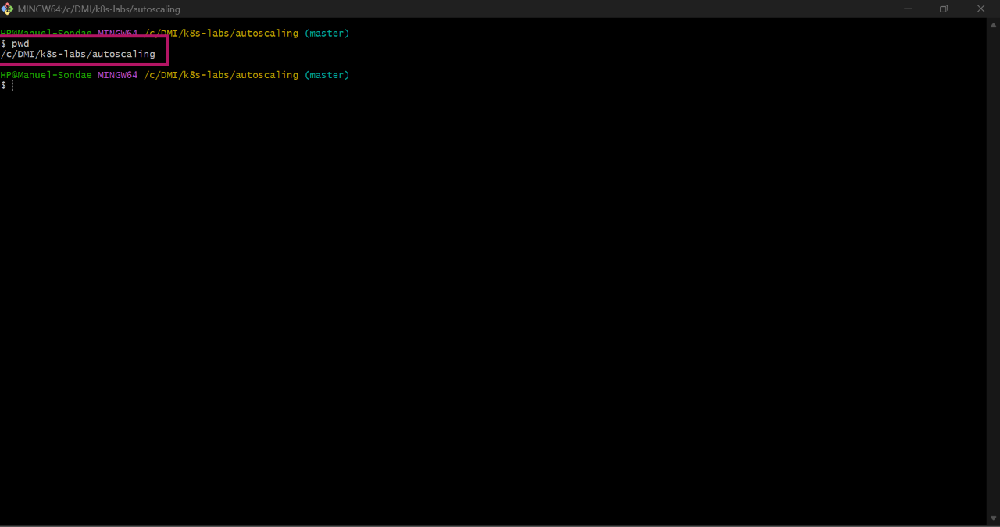

---

### Notes

**1. What is the difference between auto-healing and auto-scaling?**

Auto-healing keeps the same number of Pods running: if a Pod crashes or is deleted, Kubernetes replaces it. Auto-scaling changes the number of Pods based on load: it adds Pods when demand goes up and removes them when it goes down.

---

**2. Which Kubernetes feature will you use for CPU-based auto-scaling?**

The Horizontal Pod Autoscaler (HPA).

---

# Task 2 — Test Auto-Healing with a Deployment

## Goal

Create a Deployment with two replicas, delete one Pod, and observe Kubernetes create a replacement Pod.

### Evidence

#### Screenshot 2 — Completed `autohealing-deployment.yaml` manifest

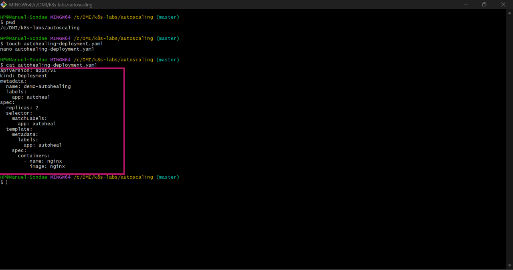

---

#### Screenshot 3 — Output of `kubectl get pods` showing two running Pods before deletion

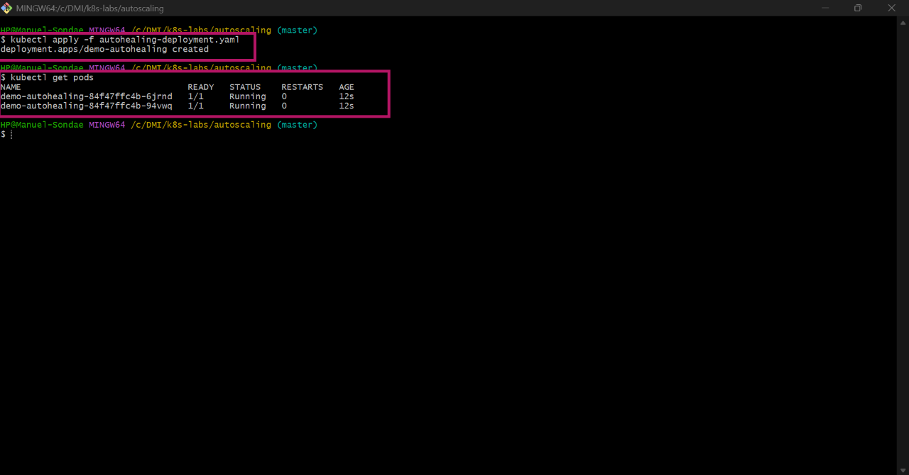

---

#### Screenshot 4 — Output of the `kubectl delete pod` command

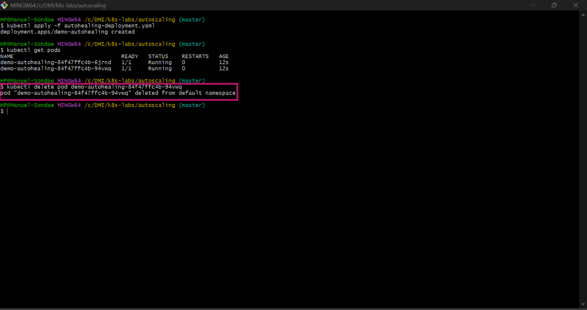

---

#### Screenshot 5 — Output of `kubectl get pods` showing the replacement Pod and two running Pods

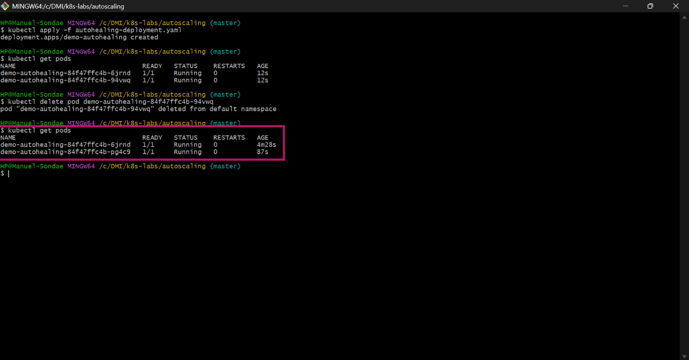

---

### Notes

**1. What happened after you deleted one Pod?**

The Pod was terminated, and a new Pod with a different name was created straight away. After a few seconds there were two Pods running again.

---

**2. What Kubernetes resource maintains the desired replica count for this Deployment?**

The ReplicaSet that the Deployment creates and manages. It keeps comparing the number of running Pods with the desired replicas and creates a new Pod when one is missing.

---

**3. What proves that auto-healing worked?**

kubectl get pods showed two Pods 1/1 Running again. One of them had a new name and a much younger AGE, which shows it was a replacement and not the deleted Pod.

---

# Task 3 — Create a Deployment for HPA

## Goal

Create a Deployment with CPU resource requests and limits so that HPA can calculate CPU utilization.

### Evidence

#### Screenshot 6 — Completed `hpa-deployment.yaml` manifest showing CPU requests and limits

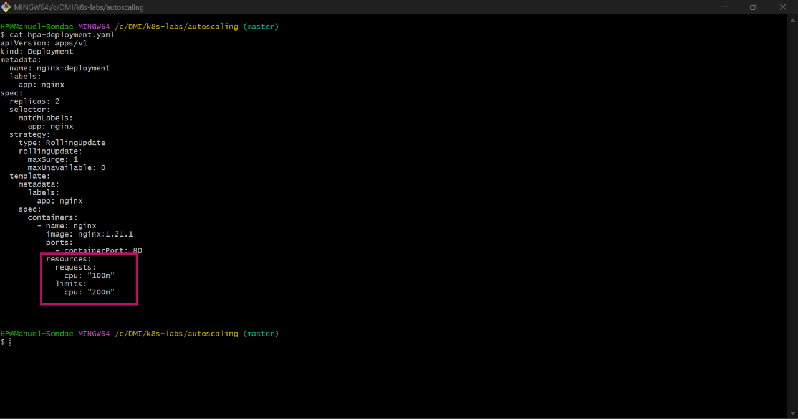

---

#### Screenshot 7 — Output showing `nginx-deployment` and its running Pods

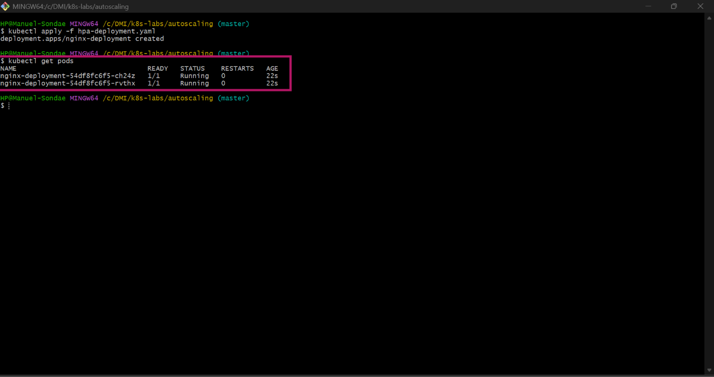

---

### Notes

**1. What does `cpu: "100m"` mean?**

100 millicores, which is 0.1 of one CPU core (1 core = 1000m)

---

**2. What is the difference between a CPU request and a CPU limit?**

The request is the CPU the container is guaranteed. The scheduler uses it to decide which node has room for the Pod. The limit is the maximum CPU the container may use. If it tries to use more, it’s throttled (slowed down).

---

**3. Why does CPU-based HPA require CPU requests?**

HPA measures CPU utilization as a percentage of the request. Without a request there’s nothing to calculate the percentage from, so the HPA shows <unknown> and can’t scale.

---

# Task 4 — Enable and Verify Metrics Server

## Goal

Ensure the cluster can collect resource metrics for the HPA.

### Evidence

#### Screenshot 8 — Output showing Metrics Server running, or `kubectl top pods` displaying Pod metrics

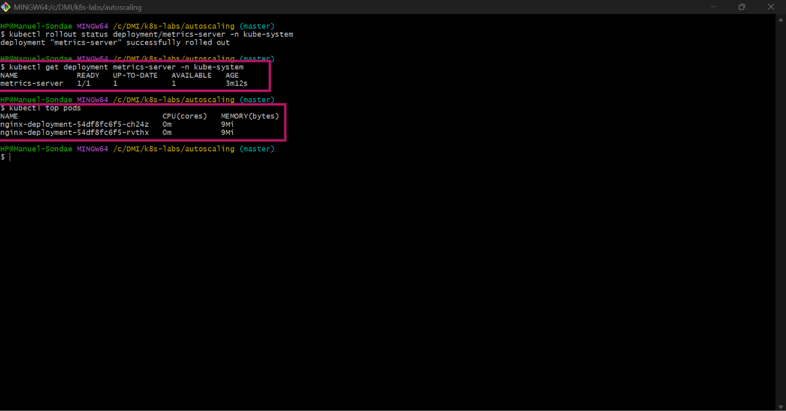

---

### Notes

**1. Why does HPA need Metrics Server?**

Metrics Server collects the CPU and memory usage of Pods and makes it available through the Kubernetes API. The HPA reads these numbers to decide whether to scale.

---

**2. What issue can occur if Metrics Server is not working?**

The HPA can’t get any CPU data, so kubectl get hpa shows <unknown> under TARGETS, and no scaling happens even under heavy load. kubectl top pods also fails.

---

**3. What does `kubectl top pods` help you check?**

It shows the current CPU and memory usage of each Pod. It confirms that Metrics Server is working and lets me see how much load the Pods are under.

---

# Task 5 — Create a Horizontal Pod Autoscaler

## Goal

Create an HPA that keeps at least two Pods running and can scale up to five Pods when average CPU utilization exceeds 50%.

### Evidence

#### Screenshot 9 — The imperative command output OR completed `hpa-nginx.yaml` manifest

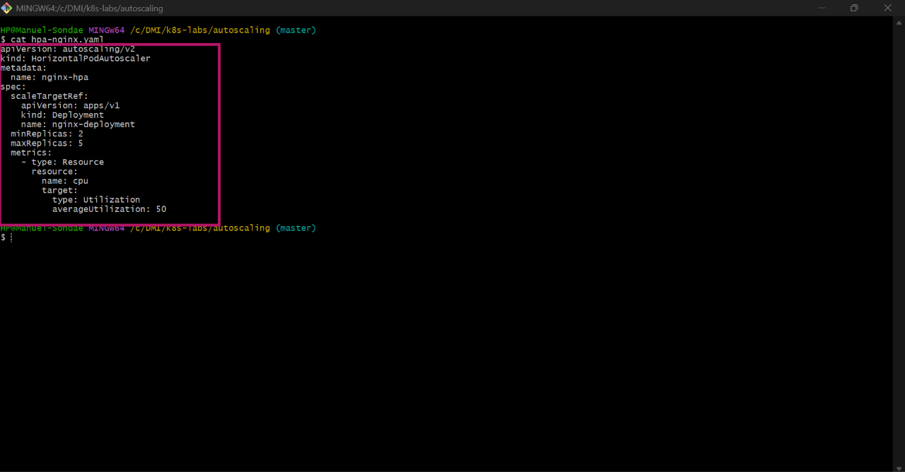

---

#### Screenshot 10 — Output of `kubectl get hpa` and the relevant `kubectl describe hpa` command

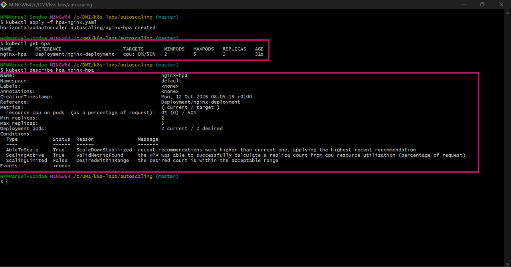

---

### Notes

**1. What does `minReplicas: 2` mean?**

The HPA always keeps at least 2 Pods running, even when there’s no load. It never scales below 2.

---

**2. What does `maxReplicas: 5` mean?**

The HPA can scale up to at most 5 Pods, however high the load gets. This protects the cluster from using too many resources.

---

**3. What does `averageUtilization: 50` mean?**

The HPA tries to keep the average CPU usage across all Pods at about 50% of their CPU request. If the average goes above 50% it adds Pods, and if it drops well below it removes them, within the min and max limits.

---

**4. Why should only one HPA manage a Deployment at a time?**

Two HPAs would each calculate their own replica count and keep overwriting each other’s changes. The number of Pods would keep jumping up and down. One HPA per Deployment keeps scaling predictable.

---

# Task 6 — Optional: Generate CPU Load and Observe Scaling

## Goal

Generate CPU load in one NGINX Pod and observe how HPA responds.

### Evidence

If you skip this task, write “Not completed — optional” and leave the remaining Task 6 placeholders blank.

Task status: completed.

#### Screenshot 11 — Terminal showing the CPU-load command running inside the selected Pod

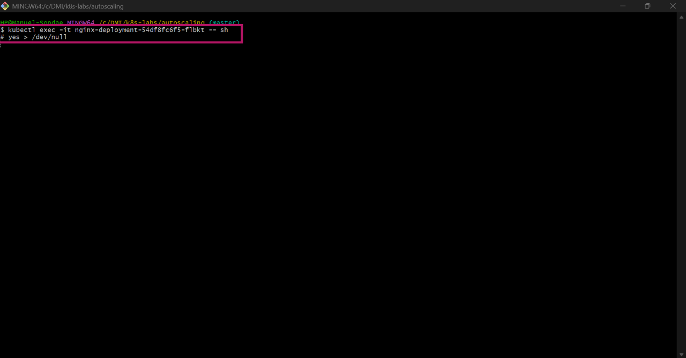

---

#### Screenshot 12 — Output of `kubectl get hpa` and `kubectl get pods` while HPA evaluates or changes the replica count

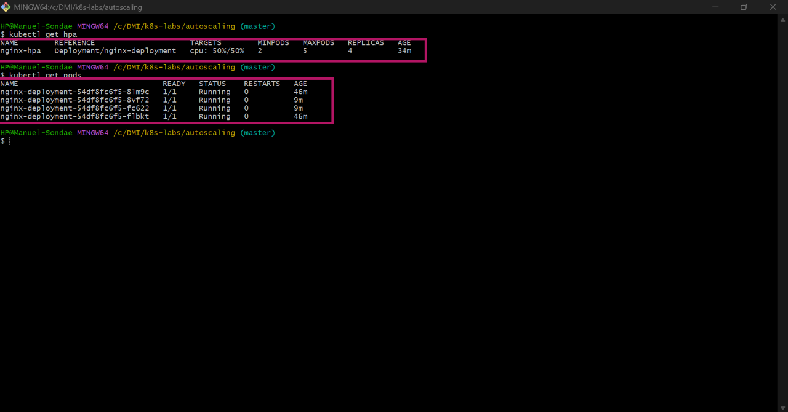

---

### Notes

Complete these answers only if you perform the optional test.

**1. Did the HPA change the number of Pods? Explain what you observed.**

Yes. When the CPU load went above the 50% target, the HPA scaled the Deployment from 2 to 4 Pods. kubectl get pods showed two new Pods with a much younger AGE than the original two. With the load shared across 4 Pods, the average CPU came down to the target (50%/50%), and the HPA kept it at 4 instead of going to the maximum of 5.

---

**2. If scaling did not happen, what are two possible reasons?**

Not applicable — scaling occurred.

---

**3. Why is automatic scale-down useful after traffic decreases?**

Extra Pods use CPU and memory, which costs money and takes resources other workloads could use. Scaling down automatically after traffic drops returns to the minimum number of Pods without anyone having to do it by hand. The HPA waits a few minutes first, so a short dip in traffic doesn’t remove Pods too early.

---

# LinkedIn Requirement

### Evidence

#### Screenshot 13 — Published LinkedIn post showing your name, the required explanation, and the attached Kubernetes screenshot

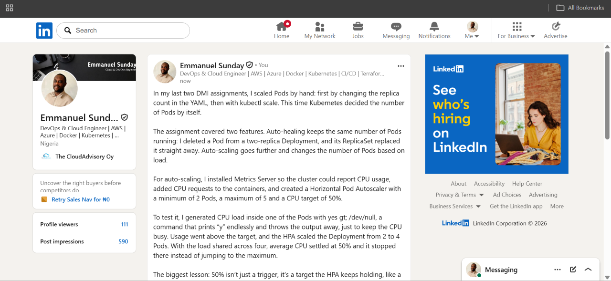

#### Linkedin Post Link

https://www.linkedin.com/posts/emmanuel-sunday-210a08323_kubernetes-devops-autoscaling-share-7515344767191515136-epD4/?utm_source=share&utm_medium=member_desktop&rcm=ACoAAFHXXywBq0IrgBBhbi5ULmCrDuZgCEYc6fQ

---

# Submission Instructions

- Include required Screenshots 1–10 and Screenshot 13.
- Include Screenshots 11–12 only if you complete Task 6.
- Full Name must be visible in required screenshots.
- Ensure screenshots are clear and readable.
- Include the completed `autohealing-deployment.yaml` and `hpa-deployment.yaml` files.
- Include `hpa-nginx.yaml` if you selected the declarative HPA method.
- Complete the Notes sections for Tasks 1–5 in your own words.
- Complete Task 6 notes only if you perform the optional test.
- Do not expose passwords, tokens, private keys, kubeconfig files, or account IDs.

---

# Completion Checklist

- [ ] Checked the active context and existing cluster resources
- [ ] Created the autoscaling working directory (Screenshot 1)
- [ ] Created `autohealing-deployment.yaml` (Screenshot 2)
- [ ] Confirmed two auto-healing Pods were running (Screenshot 3)
- [ ] Deleted one managed Pod (Screenshot 4)
- [ ] Confirmed that the Pod was automatically replaced (Screenshot 5)
- [ ] Created `hpa-deployment.yaml` with CPU requests and limits (Screenshot 6)
- [ ] Verified `nginx-deployment` and its running Pods (Screenshot 7)
- [ ] Verified Metrics Server and confirmed Pod metrics are available (Screenshot 8)
- [ ] Created one HPA using the selected method (Screenshot 9)
- [ ] Verified minimum replicas of 2, maximum replicas of 5, and a CPU target of 50% (Screenshot 10)
- [ ] Completed Notes for Tasks 1–5
- [ ] Completed Task 6 evidence and notes, or marked it “Not completed — optional”
- [ ] Stopped the CPU-load command and exited the container shell, if Task 6 was completed
- [ ] Published the LinkedIn post with the required explanation and attached screenshot (Screenshot 13)
- [ ] Included the required manifest files
- [ ] No sensitive data exposed

---

## 📌 About DMI & CloudAdvisory

DevOps Micro Internship (DMI) is a project-based DevOps program run by Pravin Mishra (The CloudAdvisory) focused on real-world execution, systems thinking, and career readiness.

It helps learners build strong DevOps foundations with hands-on experience.

---

## 📌 Resources

- 🌐 DMI Official Website: https://dmi.pravinmishra.com?utm_source=github&utm_medium=readme  
- 🎓 University: https://university.pravinmishra.com?utm_source=github&utm_medium=readme  
- 💬 Discord Community: https://discord.pravinmishra.com?utm_source=github&utm_medium=readme  
- 📝 Blog: https://dmi.pravinmishra.com/blog?utm_source=github&utm_medium=readme  
- ▶️ YouTube Playlist: https://www.youtube.com/playlist?list=PLFeSNDtI4Cho  
- 🔗 Pravin Mishra (LinkedIn): https://www.linkedin.com/in/pravin-mishra-aws-trainer/  
- 🏢 CloudAdvisory (LinkedIn): https://www.linkedin.com/company/thecloudadvisory/

---

*This submission is part of DevOps Micro Internship (DMI) — Agentic AI Track.*
