# Assignment 5 — Kubernetes Health Probes (Readiness)

Part of the DevOps Micro Internship (DMI) with Agentic AI

---

## Purpose

In this assignment, you will configure and test a Kubernetes readiness probe. You will create a baseline NGINX Deployment, add an HTTP readiness probe, intentionally break it, observe a stalled rollout, and restore the working configuration.

You will also demonstrate how readiness probes protect rolling updates.

---

# Task 0 — Prepare the Lab Environment

## Goal

Confirm that you are connected to your learning cluster and remove the previous assignment’s HPA and NGINX Deployment before starting this lab.

No screenshot or written notes are required for this pre-check.

---

# Task 1 — Set Up Your Lab Directory

## Goal

Create and enter a dedicated directory for the readiness-probe lab.

### Evidence

#### Screenshot 1 — Terminal showing that you are working inside `~/k8s-labs/health-probes-readiness`

---

### Notes

**1. What is the purpose of a readiness probe?**

It checks whether a container is actually ready to handle requests. Only Pods that pass the check receive traffic. If the check fails, the Pod is taken out of service until it passes again, but it isn’t restarted.

**2. Why is a Pod being Running not always enough to confirm it can serve traffic?**

Running only means the container process has started. The app inside may still be loading, waiting for a database, or failing to respond correctly. A readiness probe checks whether the app actually answers, not just whether the container exists.

---

# Task 2 — Create a Baseline Deployment Without Probes

## Goal

Create a baseline NGINX Deployment with two replicas and no readiness probe.

### Evidence

#### Screenshot 2 — Completed `00-nginx-deploy-baseline.yaml` manifest

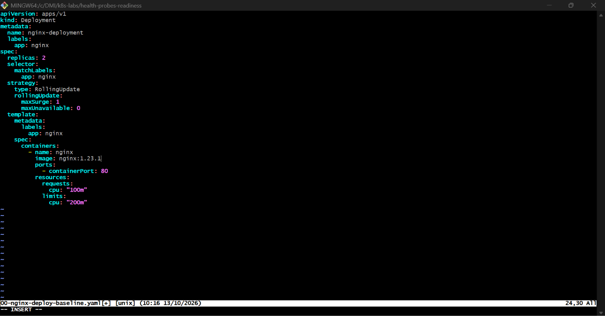

---

#### Screenshot 3 — Output showing a successful rollout and two running NGINX Pods

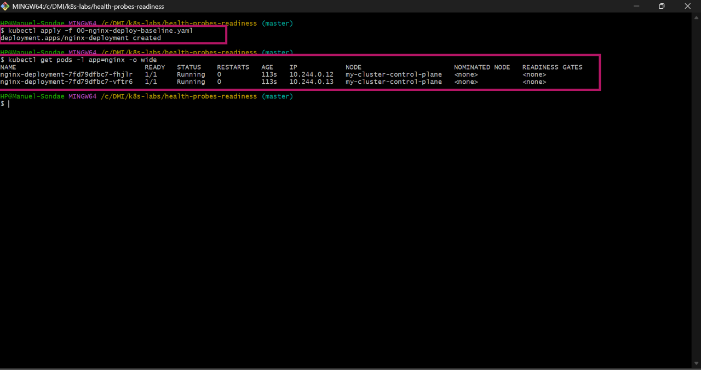

---

#### Screenshot 4 — Relevant output from `kubectl describe deployment nginx-deployment`

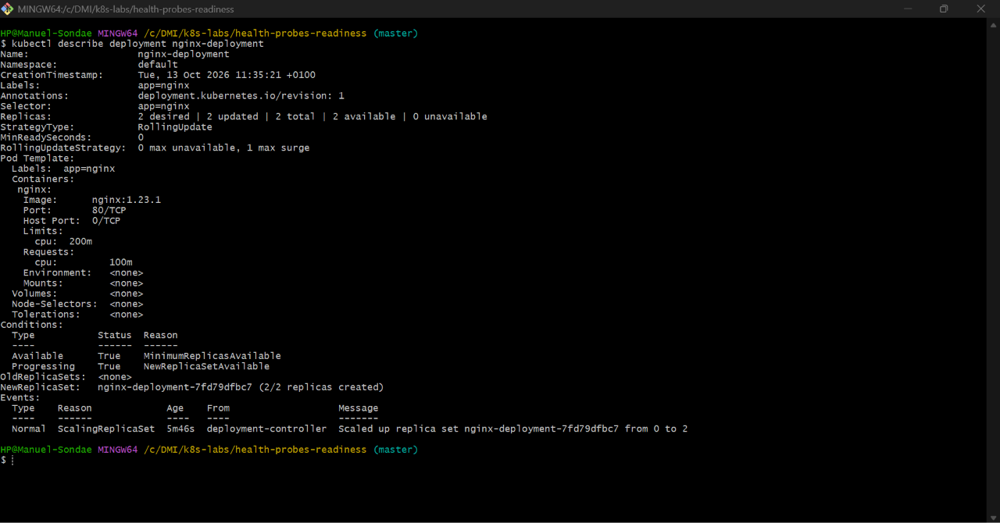

---

### Notes

**1. How many replicas does this Deployment maintain?**

Two.

**2. What does `maxUnavailable: 0` mean during a rolling update?**

No Pod may be unavailable during the update. Kubernetes must start a new Pod and wait until it’s ready before removing an old one, so the number of available Pods never drops below two.

**3. Is a readiness probe configured in this baseline Deployment?**

No. Without a probe, Kubernetes treats a Pod as ready as soon as its container starts.

---

# Task 3 — Add a Readiness Probe

## Goal

Add an HTTP readiness probe so Kubernetes checks whether each NGINX container is ready to accept requests.

### Evidence

#### Screenshot 5 — Completed `01-nginx-deploy-readiness.yaml` manifest showing the readiness probe

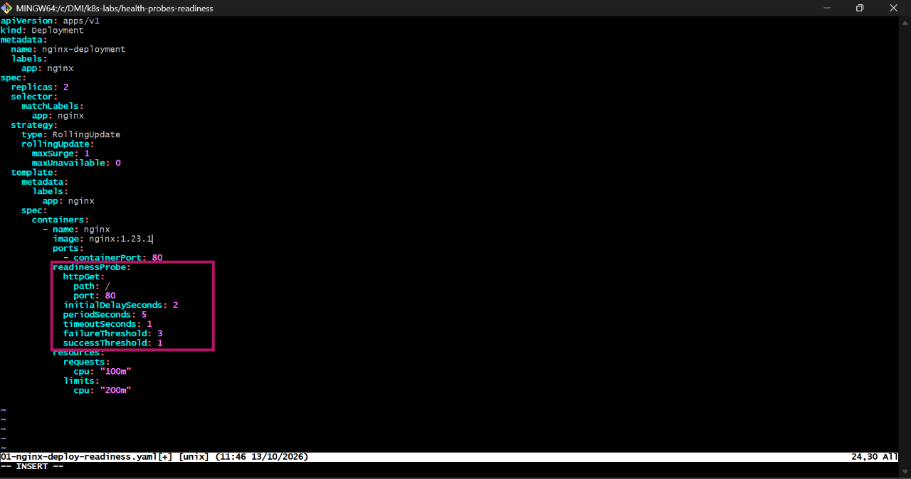

---

#### Screenshot 6 — Output of the successful rollout and ready Pods

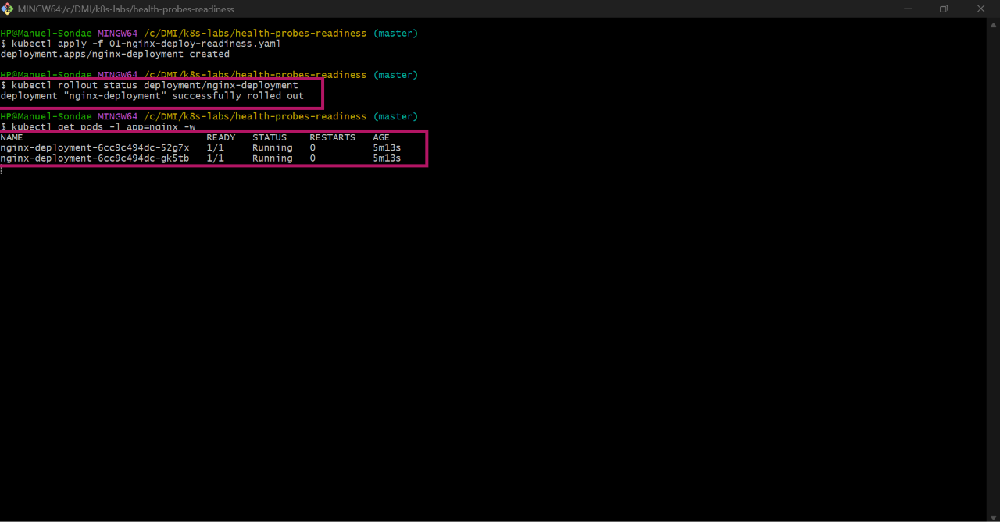

---

#### Screenshot 7 — Pod description showing readiness conditions and readiness probe details

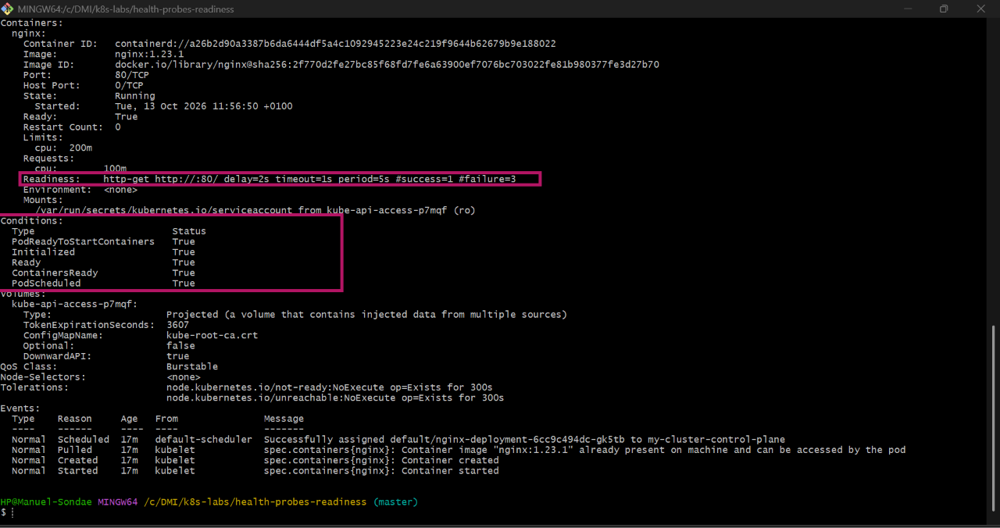

---

### Notes

**1. What path and port does the readiness probe check?**

It sends an HTTP GET request to path / on port 80.

**2. What does `initialDelaySeconds: 2` do?**

Kubernetes waits 2 seconds after the container starts before running the first readiness check. This gives NGINX time to start.

**3. What does `periodSeconds: 5` do?**

The readiness check runs every 5 seconds for as long as the Pod is running.

**4. What must happen before Kubernetes considers this Pod ready?**

The probe must get a successful HTTP response (a status code from 200 to 399) from / on port 80. After a successful check, the Pod’s Ready condition becomes True and it can receive traffic

---

# Task 4 — Break and Restore Readiness

## Goal

Intentionally fail the readiness probe, observe the NotReady behavior, and then restore the working probe configuration.

### Evidence

#### Screenshot 8 — `02-nginx-readiness-broken.yaml` showing `/does-not-exist`

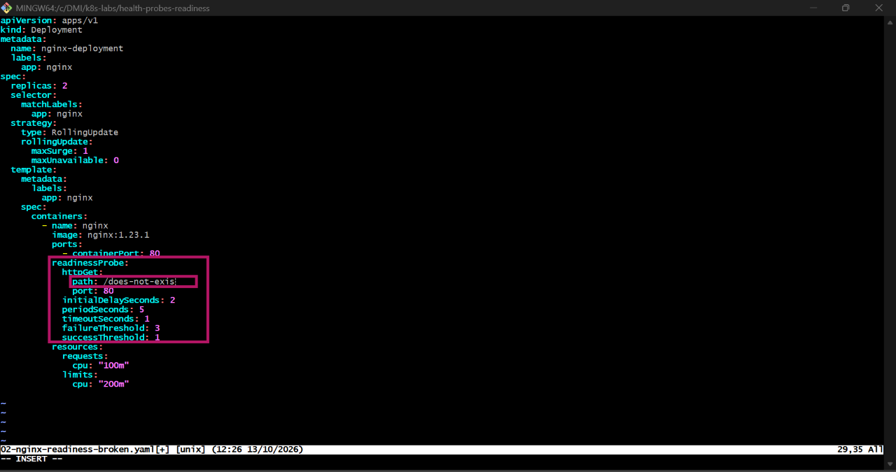

---

#### Screenshot 9 — Output showing the rollout timeout or incomplete rollout

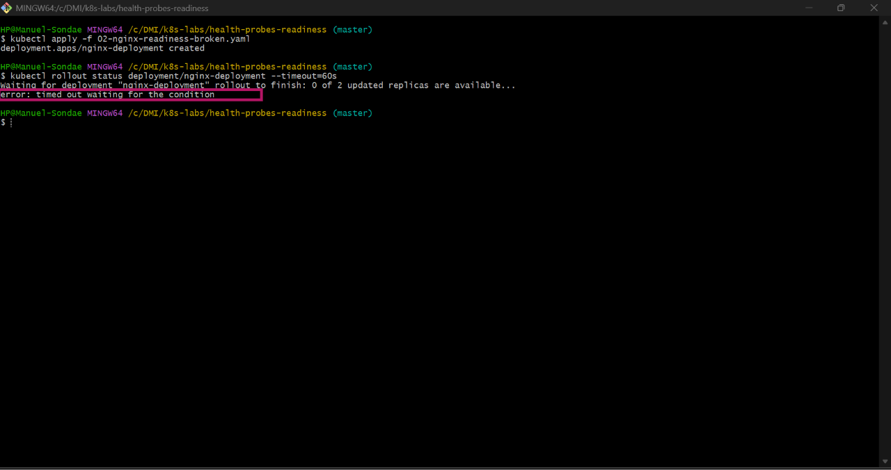

---

#### Screenshot 10 — Pod details showing `Ready: False` or readiness-probe failure events

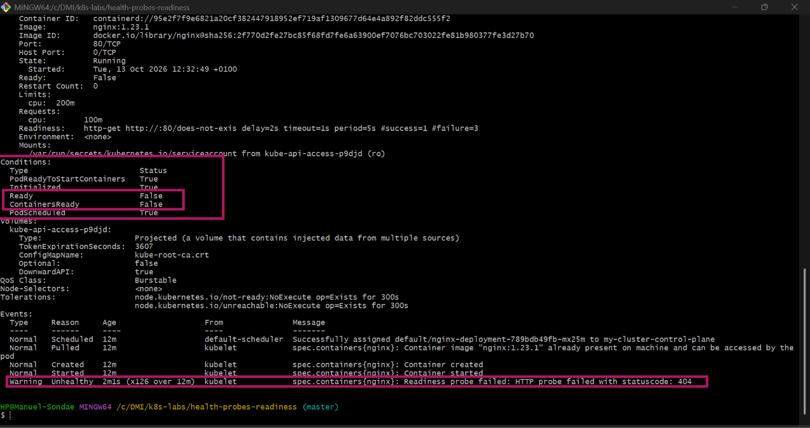

---

#### Screenshot 11 — Output showing successful rollout and ready Pods after the fix

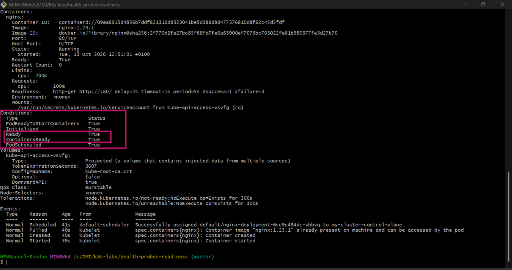

---

### Notes

**1. Why did the readiness probe fail?**

The probe checked /does-not-exist, a path NGINX doesn’t serve. NGINX returned 404 Not Found, which counts as a failed check.

**2. What happened to the Pod readiness status?**

The Pod stayed Running, but showed 0/1 under READY, and its Ready condition was False. The events showed repeated readiness probe failures. The container wasn’t restarted, because a failed readiness probe only stops traffic. It doesn’t kill the container.

**3. Why did the rollout fail to complete?**

The new Pod never became ready. With maxUnavailable: 0, Kubernetes can’t remove an old Pod until a new one is ready, so the rollout waited and kubectl rollout status timed out

**4. How did you restore the Deployment successfully?**

I applied the manifest with the correct readiness path (kubectl apply -f 03-nginx-readiness-fixed.yaml). The new Pods passed the probe, became ready, and the rollout completed.

---

# Task 5 — See How Readiness Protects Rolling Updates

## Goal

Observe how readiness prevents a bad new Pod from replacing healthy Pods during a rolling update.

### Evidence

#### Screenshot 12 — Successful update command and rollout status

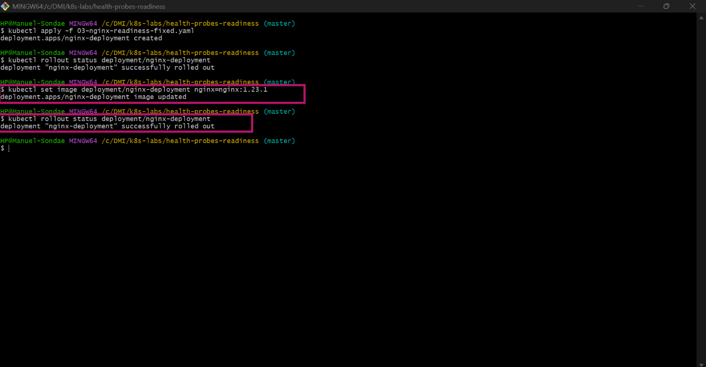

---

#### Screenshot 13 — ReplicaSets and Pods after the successful rolling update

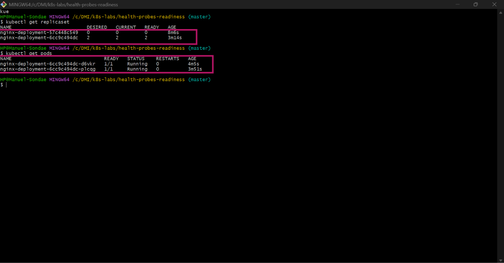

---

#### Screenshot 14 — Completed `04-readiness-broken-patch.yaml`

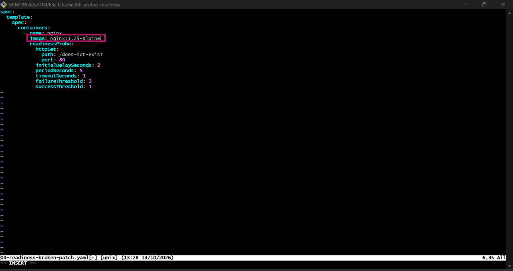

---

#### Screenshot 15 — Output showing the expected stalled rollout or timeout

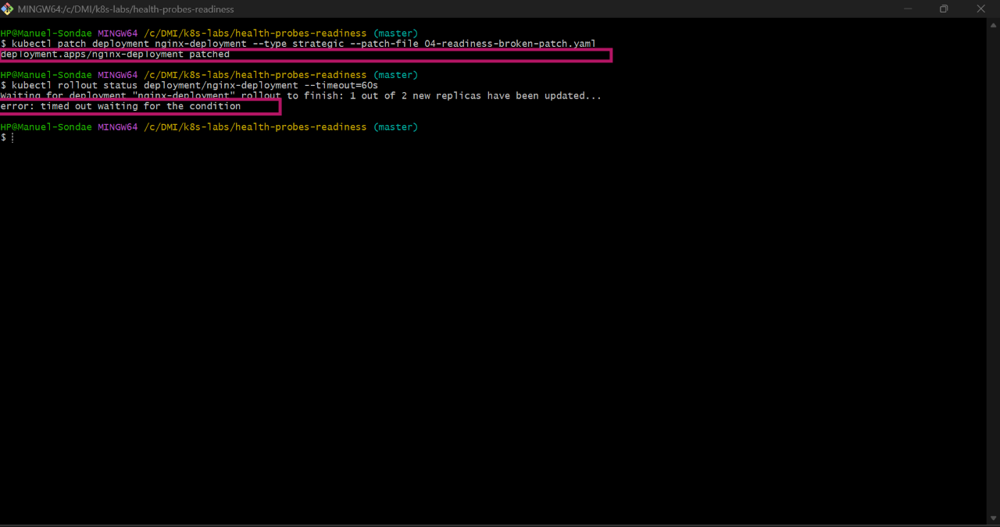

---

#### Screenshot 16 — Deployment or Pod output showing the effect of the broken readiness probe

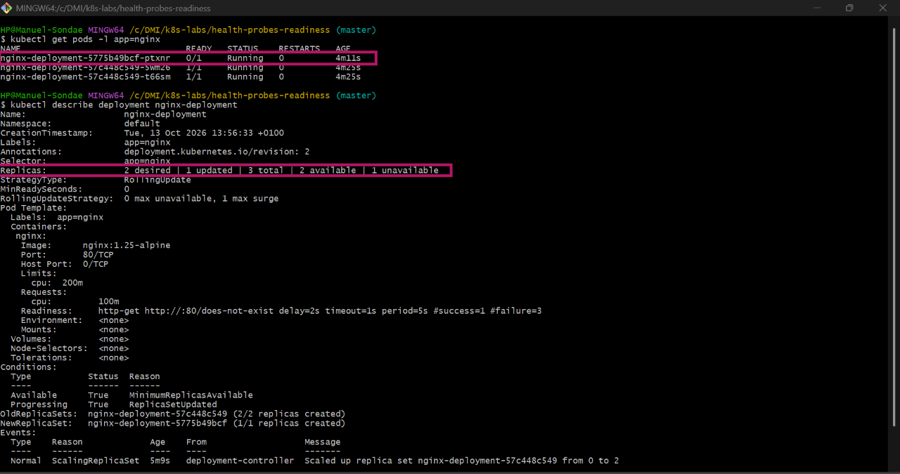

---

#### Screenshot 17 — Successful rollout status after restoring the fixed configuration

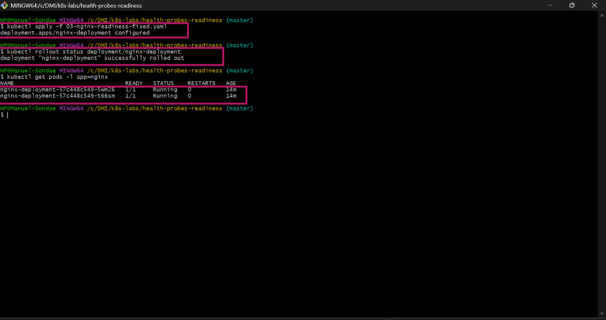

---

### Notes

**1. What happened during the successful rolling update?**

When I changed the image, Kubernetes created a new Pod with the new version, waited until it passed the readiness probe, and only then removed an old Pod. It repeated this until all Pods ran the new image. Two ready Pods were available the whole time.

**2. Why did Kubernetes create a new ReplicaSet?**

Changing the Pod template (here, the image) creates a new version of the template. Each version gets its own ReplicaSet. The new one scales up while the old one scales down to 0, and the old one is kept so the change can be rolled back.

**3. Why were the new Pods unable to replace the existing healthy Pods after readiness was broken?**

The patch changed the image and pointed the readiness probe at /does-not-exist. The new Pod failed the check and never became ready. Kubernetes only removes old Pods once their replacements are ready, so the healthy old Pods stayed in place and kept serving traffic.

**4. How does `maxUnavailable: 0` protect availability during this rollout?**

It doesn’t allow any Pod to be taken away before a ready replacement exists. Even though the new version was broken, the two old Pods kept running and serving traffic, so users weren’t affected. The broken version simply never took over.

---

# Task 6 — Share Your Readiness-Probe Learning on LinkedIn

## Goal

Share what you learned about Kubernetes readiness probes and how they protect rolling updates.

### Evidence

#### Screenshot 18 — Published LinkedIn post

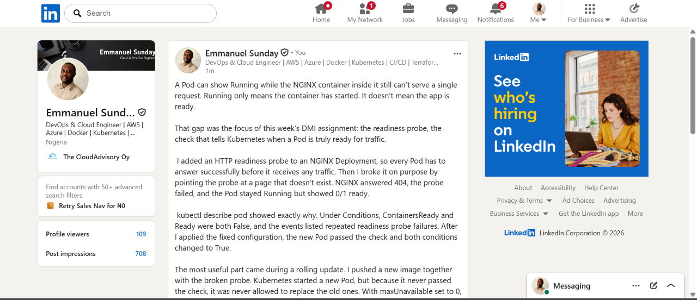

#### Linkedin post link

https://www.linkedin.com/posts/emmanuel-sunday-210a08323_kubernetes-devops-readinessprobe-ugcPost-7515768923326300160-T6q_/?utm_source=share&utm_medium=member_desktop&rcm=ACoAAFHXXywBq0IrgBBhbi5ULmCrDuZgCEYc6fQ

---

# Submission Instructions

- Add all required screenshots numbered 1–18.
- Ensure your full name is visible in required screenshots.
- Use clear, readable screenshots showing the relevant manifest or output.
- Include the completed baseline and readiness-probe manifests in your repository.
- Answer all Notes questions for Tasks 1–5 in your own words.
- Include evidence of the intentional readiness failure and successful recovery.
- Do not expose tokens, passwords, kubeconfig files, account IDs, or other sensitive information.

---

# Completion Checklist

- [ ] Learning cluster confirmed and previous assignment resources removed where applicable
- [ ] Readiness-probe lab directory created (Screenshot 1)
- [ ] Baseline Deployment created successfully (Screenshot 2)
- [ ] Two baseline Pods running and successful rollout verified (Screenshot 3)
- [ ] Baseline Deployment details reviewed (Screenshot 4)
- [ ] Readiness probe added successfully (Screenshot 5)
- [ ] Successful readiness rollout verified (Screenshot 6)
- [ ] Pod readiness conditions and probe details inspected (Screenshot 7)
- [ ] Broken readiness configuration created (Screenshot 8)
- [ ] Stalled rollout or timeout observed (Screenshot 9)
- [ ] NotReady status or readiness-probe failure events captured (Screenshot 10)
- [ ] Working readiness configuration restored (Screenshot 11)
- [ ] Successful image update completed (Screenshot 12)
- [ ] ReplicaSets and Pods inspected after the update (Screenshot 13)
- [ ] Broken-readiness patch created (Screenshot 14)
- [ ] Stalled rollout observed after the patch (Screenshot 15)
- [ ] Effect of broken readiness captured (Screenshot 16)
- [ ] Final recovery completed (Screenshot 17)
- [ ] LinkedIn post published (Screenshot 18)
- [ ] Notes for Tasks 1–5 completed
- [ ] Required manifests included
- [ ] All screenshots are clear and readable
- [ ] No sensitive data exposed

---

## 📌 About DMI & CloudAdvisory

DevOps Micro Internship (DMI) is a project-based DevOps program run by Pravin Mishra (The CloudAdvisory) focused on real-world execution, systems thinking, and career readiness.

It helps learners build strong DevOps foundations with hands-on experience.

---

## 📌 Resources

- 🌐 DMI Official Website: https://dmi.pravinmishra.com?utm_source=github&utm_medium=readme  
- 🎓 University: https://university.pravinmishra.com?utm_source=github&utm_medium=readme  
- 💬 Discord Community: https://discord.pravinmishra.com?utm_source=github&utm_medium=readme  
- 📝 Blog: https://dmi.pravinmishra.com/blog?utm_source=github&utm_medium=readme  
- ▶️ YouTube Playlist: https://www.youtube.com/playlist?list=PLFeSNDtI4Cho  
- 🔗 Pravin Mishra (LinkedIn): https://www.linkedin.com/in/pravin-mishra-aws-trainer/  
- 🏢 CloudAdvisory (LinkedIn): https://www.linkedin.com/company/thecloudadvisory/

---

*This submission is part of DevOps Micro Internship (DMI) — Agentic AI Track.*
