# Assignment 6 — Kubernetes Health Probes (Liveness)

Part of the DevOps Micro Internship (DMI) with Agentic AI

---

## Purpose

In this assignment, you will configure and test a Kubernetes liveness probe. You will create a baseline NGINX Deployment, add an HTTP liveness probe, intentionally make it fail, observe container restarts, and restore the working configuration.

---

# Task 0 — Prepare the Lab Environment

## Goal

Confirm that you are connected to your learning cluster and remove the previous HPA and NGINX Deployment before starting this lab.

No screenshot or written notes are required for this pre-check.

---

# Task 1 — Set Up Your Lab Directory

## Goal

Create and enter a dedicated directory for the liveness-probe lab.

### Evidence

#### Screenshot 1 — Terminal showing that you are working inside `~/k8s-labs/health-probes-liveness`

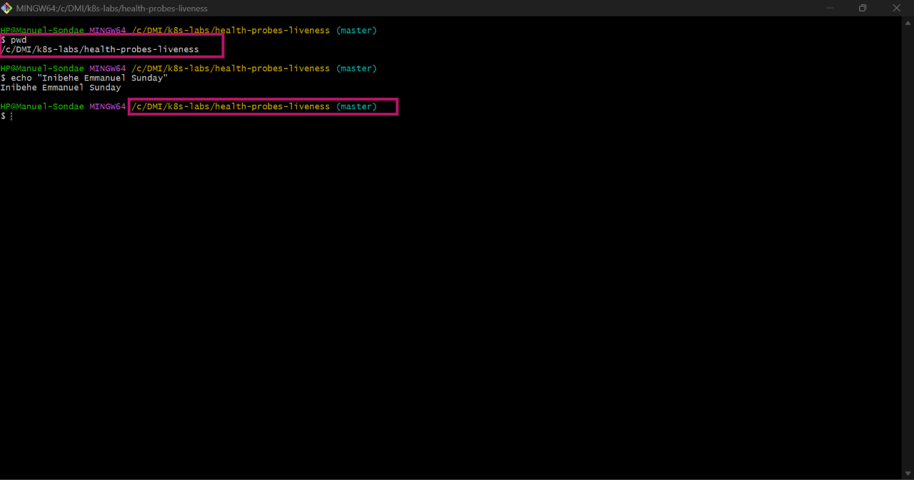

---

### Notes

**1. What problem does a liveness probe solve?**

It detects a container that is still running but has stopped working properly, for example one that is frozen or stuck. When the check keeps failing, Kubernetes restarts the container automatically, so it can recover without anyone stepping in.

**2. What is the key difference between a readiness probe and a liveness probe?**

A readiness probe decides whether a Pod receives traffic. If it fails, the Pod is removed from traffic but the container keeps running. A liveness probe decides whether the container should be restarted. If it fails repeatedly, Kubernetes kills and restarts the container.

---

# Task 2 — Create a Baseline Deployment Without Probes

## Goal

Create a baseline NGINX Deployment with two replicas and no health probes.

### Evidence

#### Screenshot 2 — Completed `00-nginx-deploy-baseline.yaml` manifest

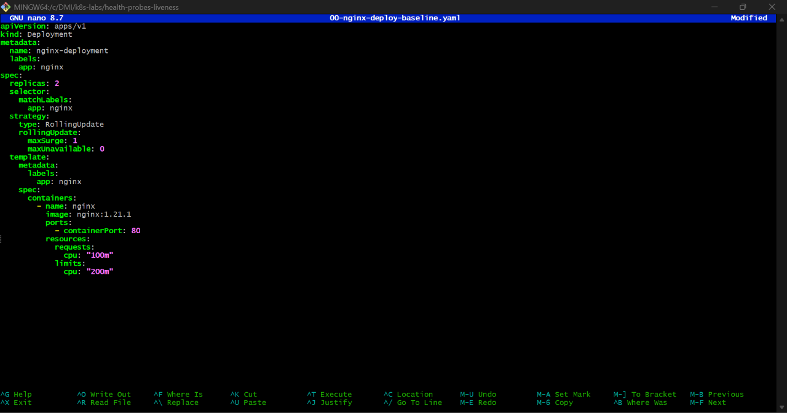

---

#### Screenshot 3 — Output showing a successful rollout and two running NGINX Pods

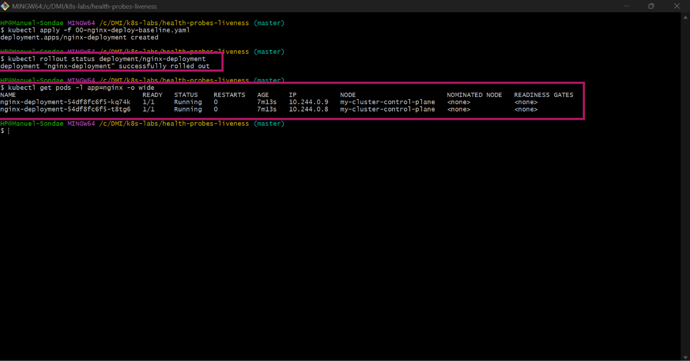

---

#### Screenshot 4 — Relevant output from `kubectl describe deployment nginx-deployment`

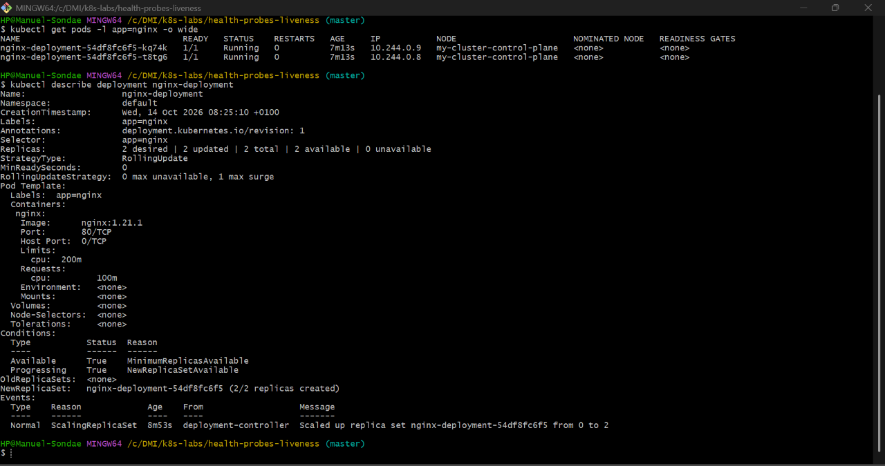

---

### Notes

**1. How many replicas does this Deployment maintain?**

Two.

**2. Are any health probes configured in the baseline Deployment?**

No. There are no readiness or liveness probes in the baseline.

**3. Why is a baseline useful before adding a liveness probe?**

It shows how the Deployment behaves when everything is normal, with no restarts and stable Pods. When I add the probe later, I can compare against this and be sure any changes, like restarts, were caused by the probe and not by something else.

---

# Task 3 — Add a Liveness Probe

## Goal

Add an HTTP liveness probe so Kubernetes can periodically check whether the NGINX container is still responsive.

### Evidence

#### Screenshot 5 — Completed `01-nginx-deploy-liveness.yaml` manifest showing the liveness probe

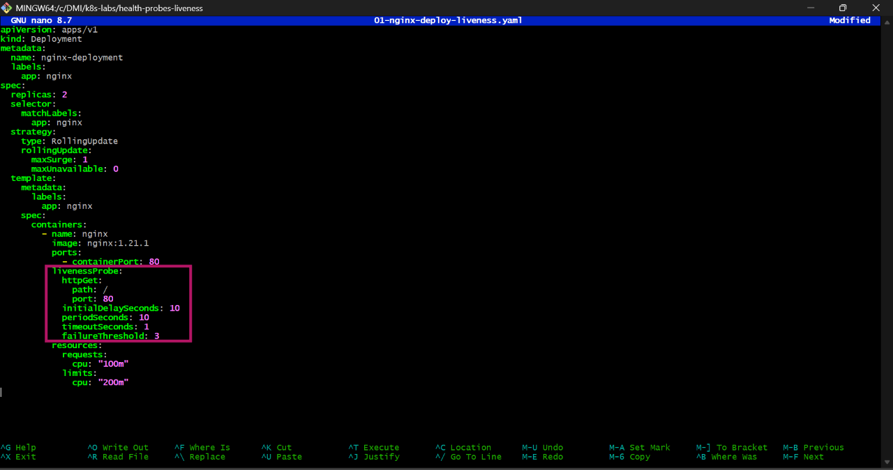

---

#### Screenshot 6 — Output showing successful rollout and running Pods

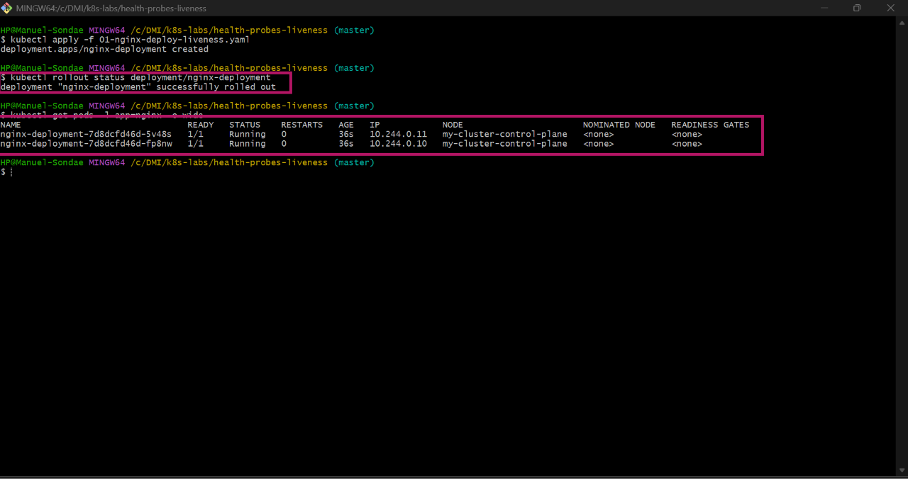

---

#### Screenshot 7 — Pod description showing liveness-probe details

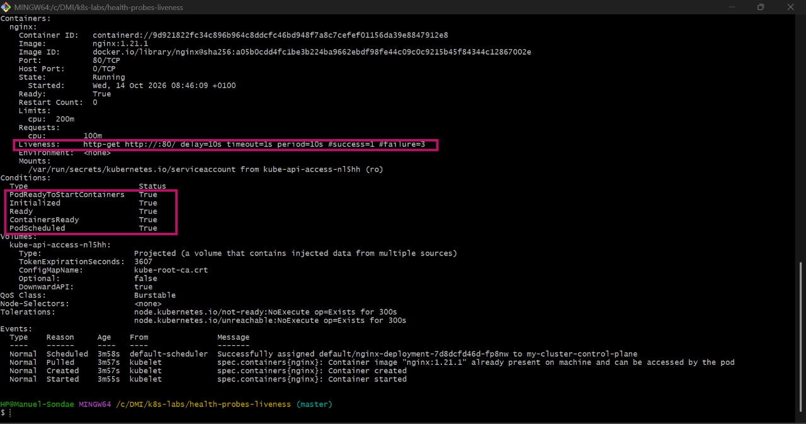

---

### Notes

**1. What path and port does the liveness probe check?**

It sends an HTTP GET request to path / on port 80.

**2. What does `initialDelaySeconds: 10` do?**

Kubernetes waits 10 seconds after the container starts before running the first liveness check. This gives NGINX time to start, so it isn’t restarted just for being slow to boot.

**3. What does `failureThreshold: 3` mean?**

The probe must fail 3 times in a row before Kubernetes treats the container as unhealthy and restarts it. A single failed check isn’t enough to trigger a restart.

**4. Does a successful liveness probe control whether a Pod receives traffic? Explain briefly.**

No. A liveness probe only decides whether the container should be restarted. Whether a Pod receives traffic is controlled by the readiness probe.

---

# Task 4 — Trigger and Observe a Liveness Restart

## Goal

Intentionally make the liveness probe fail and observe Kubernetes restart the unhealthy container.

### Evidence

#### Screenshot 8 — `02-nginx-liveness-broken.yaml` showing `/does-not-exist`

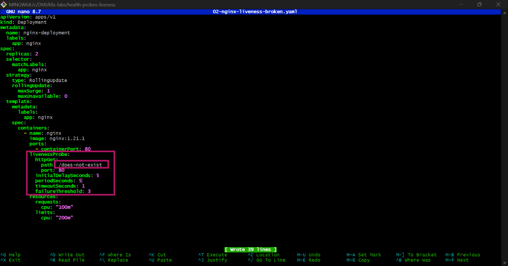

---

#### Screenshot 9 — Pod output showing an increased RESTARTS count

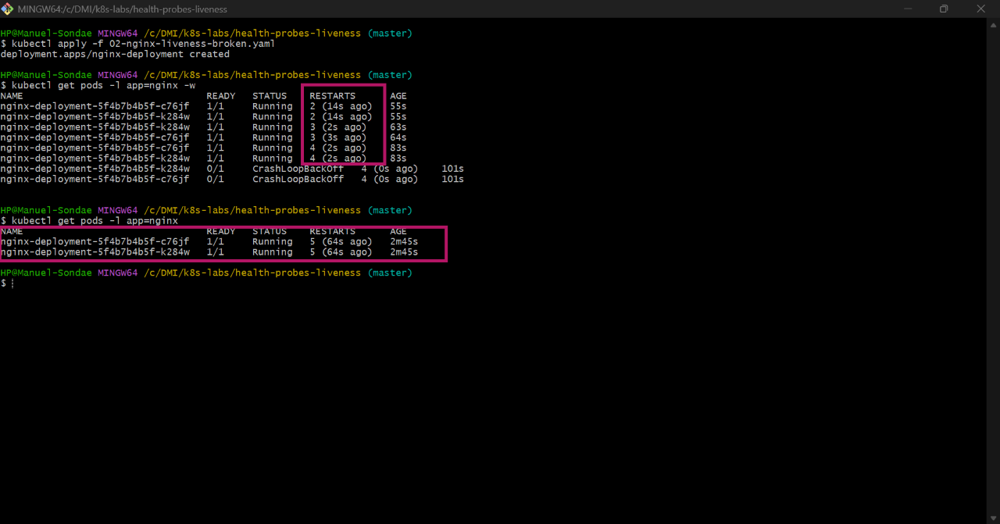

---

#### Screenshot 10 — Pod description showing liveness-probe failure events or restart details

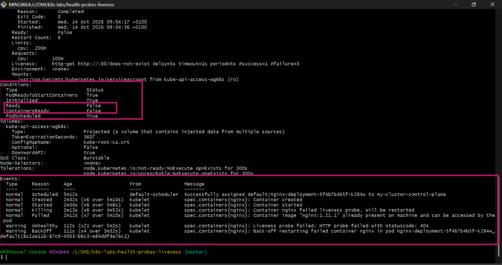

---

#### Screenshot 11 — Output showing stable running Pods after applying the fixed configuration

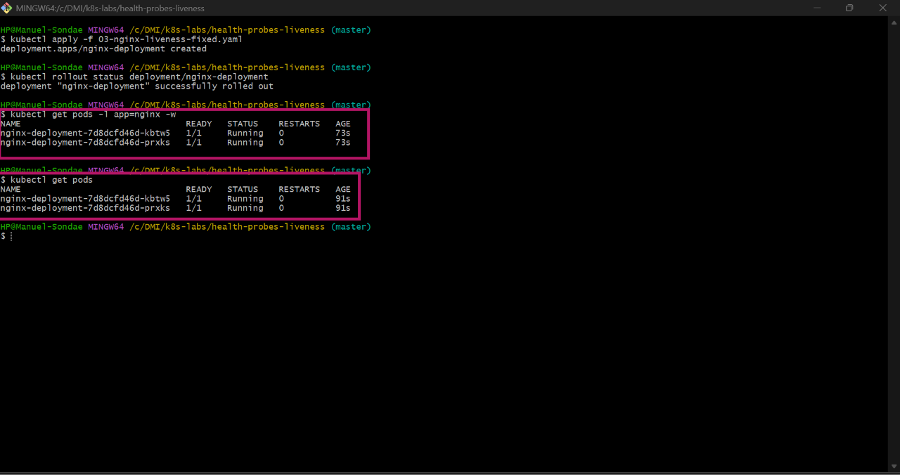

---

### Notes

**1. Why did the liveness probe fail?**

The probe checked /does-not-exist, a path NGINX doesn’t serve. NGINX returned 404 Not Found, which counts as a failed check.

**2. What happened after Kubernetes detected repeated liveness-probe failures?**

After 3 failures in a row, Kubernetes killed the NGINX container and started it again inside the same Pod. The new container ran the same broken probe, so it failed and was restarted again. After several restarts, the Pod went into CrashLoopBackOff, which I saw with kubectl get pods -w and in kubectl describe pod. This means Kubernetes was waiting longer and longer between restarts. The events showed “Liveness probe failed” and “Container nginx failed liveness probe, will be restarted”.

**3. What does the RESTARTS column prove?**

It shows how many times the container inside the Pod has been restarted. The number kept going up, and the Pod eventually reached CrashLoopBackOff, which proves Kubernetes was repeatedly restarting the container because of the failing liveness probe. The Pod itself stayed the same, with the same name. Only the container inside it was restarted.

**4. How did you restore the Deployment to a stable state?**

I applied the fixed manifest, which has the same working configuration as 01-nginx-deploy-liveness.yaml, with the liveness probe checking / on port 80. The new Pods passed the liveness check, and the RESTARTS count stopped going up.

---

# Task 5 — Optional: Observe a Restart Loop

## Goal

Observe why overly aggressive or incorrectly configured liveness probes can create restart loops.

Complete this section only if you attempt Task 5. Otherwise, mark it as “Not attempted.”

**Task status:** Completed 

### Evidence

#### Optional Screenshot — Pod output showing the RESTARTS count increasing during the restart-loop observation

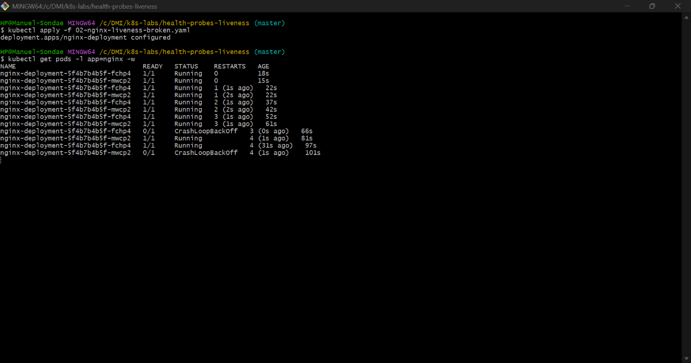

No specific restart count or CrashLoopBackOff status is required.

---

### Notes — Answer Only If Attempted

**1. What is a restart loop?**

A container that is restarted, fails again, and is restarted again, over and over. I saw this with kubectl get pods -w: the RESTARTS count kept increasing, and the Pod went into CrashLoopBackOff, where Kubernetes waits longer between each restart.

**2. Why can an aggressive liveness probe be harmful?**

If the probe checks too often, has a very short timeout, or starts too early, it can mark a healthy but slow container as dead. Kubernetes then restarts an app that was actually fine, which causes downtime instead of preventing it.

**3. Why should liveness checks be lightweight and carefully tuned?**

The check runs repeatedly for the whole life of the container. A heavy check uses resources and can fail just because the app is busy. Settings like initialDelaySeconds, timeoutSeconds and failureThreshold need to give the app enough time, so only a truly stuck container gets restarted.

---

# Task 6 — Share Your Liveness-Probe Learning on LinkedIn

## Goal

Share what you learned about Kubernetes liveness probes, container restarts, and the difference between readiness and liveness.

### Evidence

#### Screenshot 12 — Published LinkedIn post

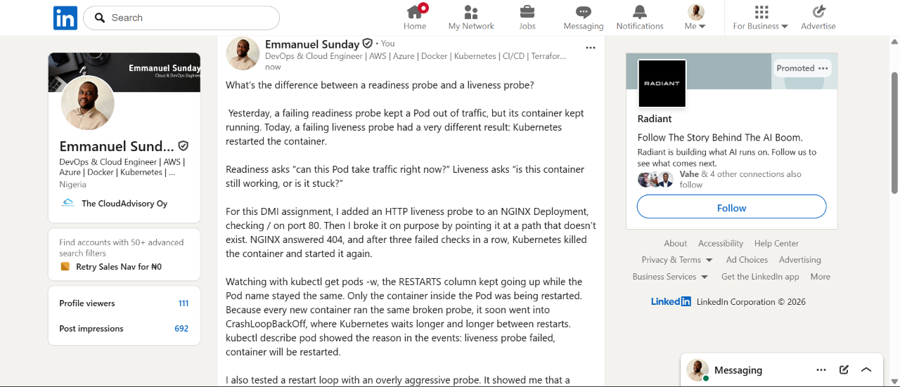

#### Linkedin post URL

https://www.linkedin.com/posts/emmanuel-sunday-210a08323_kubernetes-devops-livenessprobe-ugcPost-7516080106826539008-i_8-/?utm_source=share&utm_medium=member_desktop&rcm=ACoAAFHXXywBq0IrgBBhbi5ULmCrDuZgCEYc6fQ

---

# Submission Instructions

- Add all required screenshots numbered 1–12.
- Include the optional Task 5 screenshot only if you attempt that task.
- Ensure your full name is visible in required screenshots.
- Use clear, readable screenshots showing the relevant manifest or output.
- Include the completed baseline and liveness-probe manifests in your repository.
- Answer all Notes questions for Tasks 1–4 in your own words.
- If you attempt Task 5, complete its Notes and restore the working configuration afterward.
- Do not expose tokens, passwords, kubeconfig files, account IDs, or other sensitive information.

---

# Completion Checklist

- [ ] Learning cluster confirmed and previous assignment resources removed where applicable
- [ ] Liveness-probe lab directory created (Screenshot 1)
- [ ] Baseline Deployment manifest completed (Screenshot 2)
- [ ] Successful rollout and two baseline Pods verified (Screenshot 3)
- [ ] Baseline Deployment details reviewed (Screenshot 4)
- [ ] Liveness probe added successfully (Screenshot 5)
- [ ] Successful liveness-probe rollout verified (Screenshot 6)
- [ ] Liveness-probe details inspected (Screenshot 7)
- [ ] Broken liveness configuration created (Screenshot 8)
- [ ] Increased container restart count observed (Screenshot 9)
- [ ] Liveness-probe failure events or restart details captured (Screenshot 10)
- [ ] Working liveness configuration restored and stable Pods verified (Screenshot 11)
- [ ] Optional Task 5 evidence and Notes completed, if attempted
- [ ] Working configuration restored after Task 5, if attempted
- [ ] LinkedIn post published (Screenshot 12)
- [ ] Notes for Tasks 1–4 completed
- [ ] Required manifests included
- [ ] All required screenshots are clear and readable
- [ ] No sensitive data exposed

---

## 📌 About DMI & CloudAdvisory

DevOps Micro Internship (DMI) is a project-based DevOps program run by Pravin Mishra (The CloudAdvisory) focused on real-world execution, systems thinking, and career readiness.

It helps learners build strong DevOps foundations with hands-on experience.

---

## 📌 Resources

- 🌐 DMI Official Website: https://dmi.pravinmishra.com?utm_source=github&utm_medium=readme  
- 🎓 University: https://university.pravinmishra.com?utm_source=github&utm_medium=readme  
- 💬 Discord Community: https://discord.pravinmishra.com?utm_source=github&utm_medium=readme  
- 📝 Blog: https://dmi.pravinmishra.com/blog?utm_source=github&utm_medium=readme  
- ▶️ YouTube Playlist: https://www.youtube.com/playlist?list=PLFeSNDtI4Cho  
- 🔗 Pravin Mishra (LinkedIn): https://www.linkedin.com/in/pravin-mishra-aws-trainer/  
- 🏢 CloudAdvisory (LinkedIn): https://www.linkedin.com/company/thecloudadvisory/

---

*This submission is part of DevOps Micro Internship (DMI) — Agentic AI Track.*
