# Assignment 7 — Kubernetes Services (ClusterIP)

Part of the DevOps Micro Internship (DMI) with Agentic AI

---

## Purpose

In this assignment, you will create and test a Kubernetes ClusterIP Service. You will connect it to a healthy NGINX Deployment, access it using DNS and its ClusterIP, break and restore its selector, and observe how readiness affects Service routing.

---

# Task 0 — Prepare the Lab Environment

## Goal

Confirm your learning-cluster context and remove previous lab resources where applicable before starting this assignment.

No screenshot or written notes are required for this pre-check.

---

# Task 1 — Set Up Your Lab Directory

## Goal

Create and enter a dedicated directory for the ClusterIP Service lab.

### Evidence

#### Screenshot 1 — Terminal showing that you are working inside `~/k8s-labs/services/clusterip`

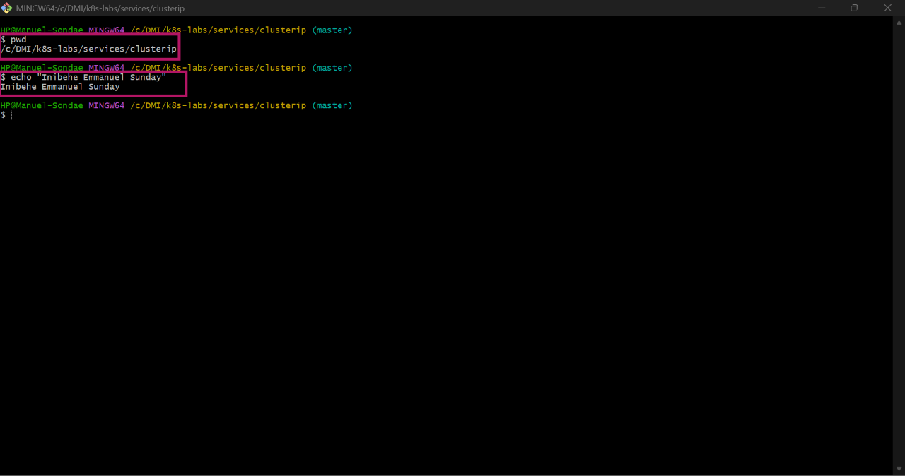

---

### Notes

**1. Why is it not reliable to communicate with an application using a Pod IP address?**

Pod IP addresses are completely ephemeral and dynamic. If a Pod crashes, restarts, or scales, Kubernetes destroys it and spins up a new one with a completely different IP address, which breaks any hardcoded connections.

**2. What Kubernetes resource provides a stable internal address for a group of Pods?**

A Kubernetes Service (specifically a ClusterIP Service) provides a permanent, unchanging internal IP address and DNS name for a grouped set of Pods.

---

# Task 2 — Create a Healthy NGINX Deployment

## Goal

Create an NGINX Deployment with labels, readiness probes, and liveness probes that can act as the backend for a Service.

### Evidence

#### Screenshot 2 — Completed `00-nginx-deploy.yaml` manifest

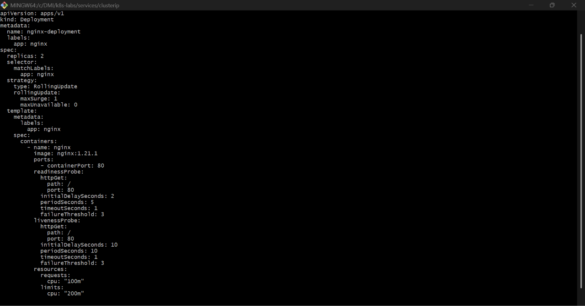

---

#### Screenshot 3 — Output showing successful rollout and two ready NGINX Pods

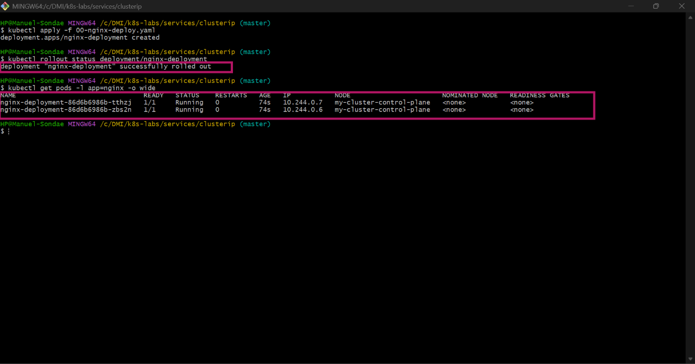

---

### Notes

**1. Which label will the Service use to find these Pods?**

The Service will use the label selector app: nginx to dynamically locate and track all matching backend Pods managed by the Deployment.

**2. Why is readiness important before connecting Pods to a Service?**

A readiness probe ensures a container has fully initialized, loaded its configurations, and is actually capable of handling traffic. It prevents the Service from routing live user requests to a booting or crashed container.

**3. What port does the NGINX container listen on?**

By default, the standard NGINX container image is configured to listen on network port 80 for incoming HTTP traffic.

---

# Task 3 — Create a ClusterIP Service

## Goal

Create a stable internal Service that routes traffic to the NGINX Pods.

### Evidence

#### Screenshot 4 — Completed `01-nginx-svc-clusterip.yaml` manifest

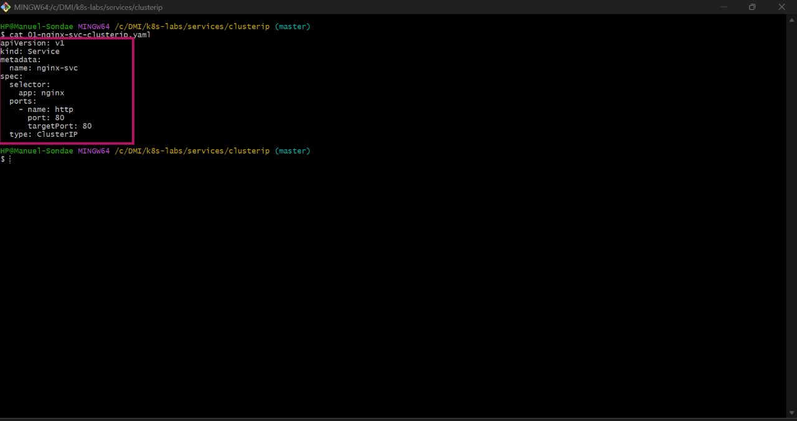

---

#### Screenshot 5 — Output showing the ClusterIP Service, endpoints, or EndpointSlices

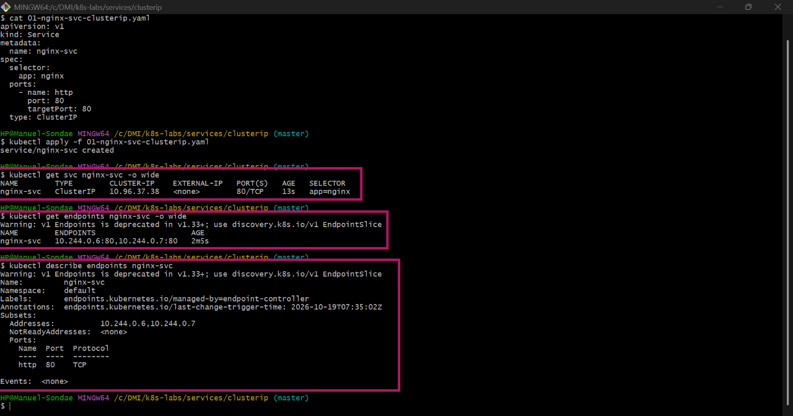

---

### Notes

**1. What is the purpose of a ClusterIP Service?**

A ClusterIP Service provides a stable, internal-only virtual IP address and DNS endpoint within the cluster. It acts as an internal load balancer that routes internal traffic seamlessly to a dynamic pool of backend Pods.

**2. What is the difference between `port` and `targetPort`?**

The port is the external port number that the Service exposes to other cluster components, while the targetPort is the internal port number on the destination Pod container where the traffic is ultimately received.

**3. Why must the Service selector match the Pod labels?**

The Service uses its selector as a query tool to identify its target backends. If the Service selector does not exactly match the metadata labels stamped on the Pods, the Service will not find any endpoints and traffic routing will fail.

**4. What information do EndpointSlices contain?**

EndpointSlices store a scalable, chunked list of network endpoints, containing the live IP addresses, target ports, and the real-time readiness status (ready: true/false) of all matching Pods.

---

# Task 4 — Access the Service from Inside the Cluster

## Goal

Create a client Pod and access the NGINX Service using DNS and its ClusterIP.

### Evidence

#### Screenshot 6 — Output showing the `tester` Pod running

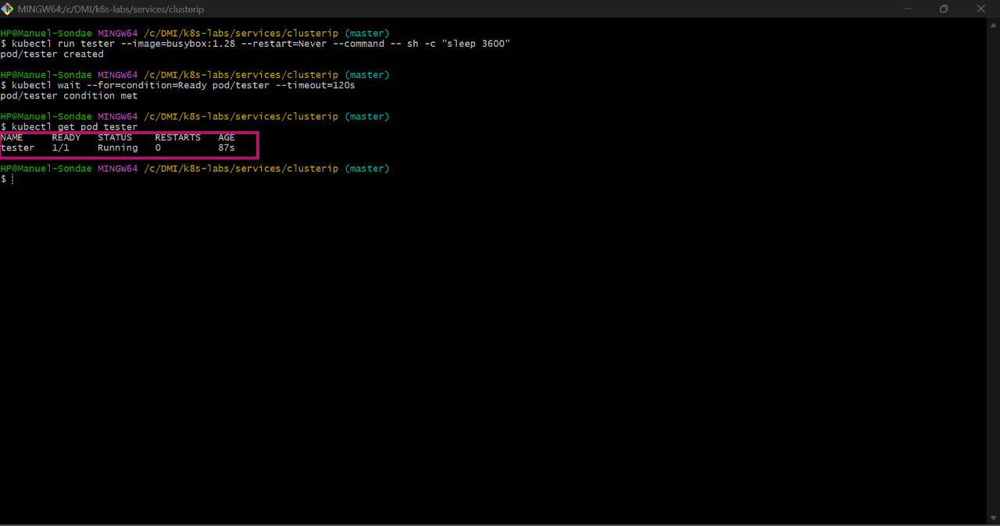

---

#### Screenshot 7 — Successful Service request using DNS name and ClusterIP

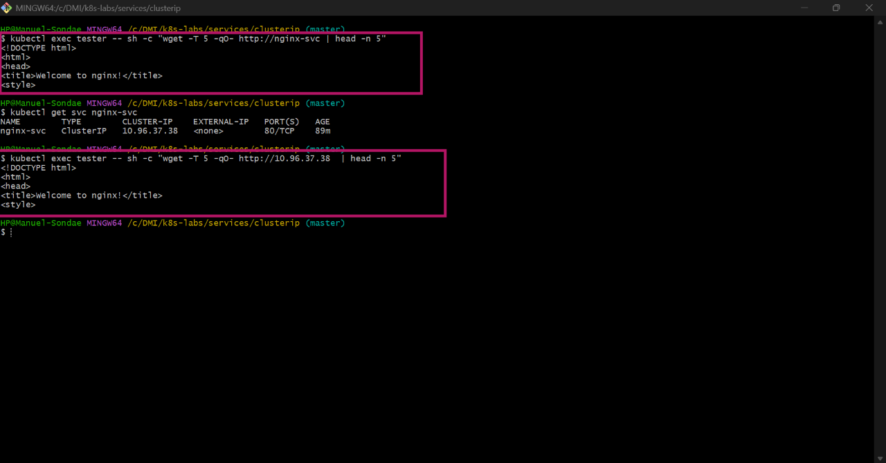

---

#### Screenshot 8 — Successful DNS lookup for the Service

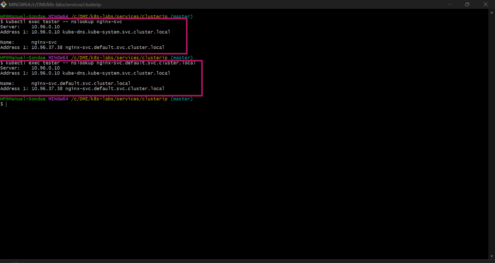

---

### Notes

**1. Why should an application use `nginx-svc` instead of a Pod IP address?**

Using the Service DNS name (nginx-svc) provides a human-readable, permanent address that stays the same forever. This abstracts away individual Pod lifetimes and saves developers from hardcoding constantly changing IP addresses.

**2. What does the DNS name `nginx-svc.default.svc.cluster.local` represent?**

It represents the fully qualified domain name (FQDN) of the Service, mapping the service name (nginx-svc), the namespace (default), and the resource type (svc) to its dedicated, internal ClusterIP.

**3. Why can the client access the Service even if the backend Pod IPs change?**

The client sends traffic directly to the unchanging ClusterIP address. The underlying kube-proxy agent handles the translation automatically, tracking live Pod IP switches in the background without the client ever knowing.

---

# Task 5 — Break and Restore the Label-Selector Contract

## Goal

Break the Service selector, observe that usable endpoints disappear, and then restore the correct selector.

### Evidence

#### Screenshot 9 — `02-nginx-svc-selector-broken.yaml` showing the incorrect selector

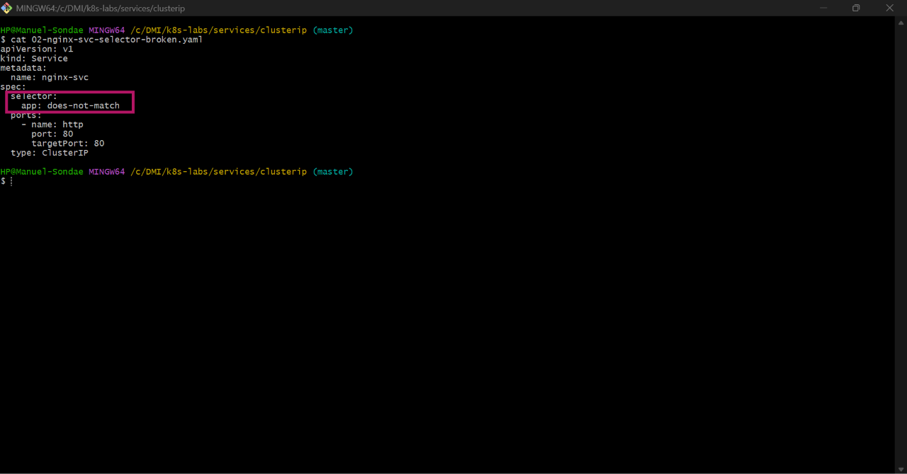

---

#### Screenshot 10 — Empty endpoints or EndpointSlice output after applying the broken selector

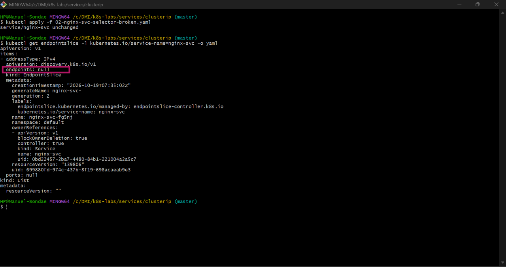

---

#### Screenshot 11 — Failed request output from the `tester` Pod

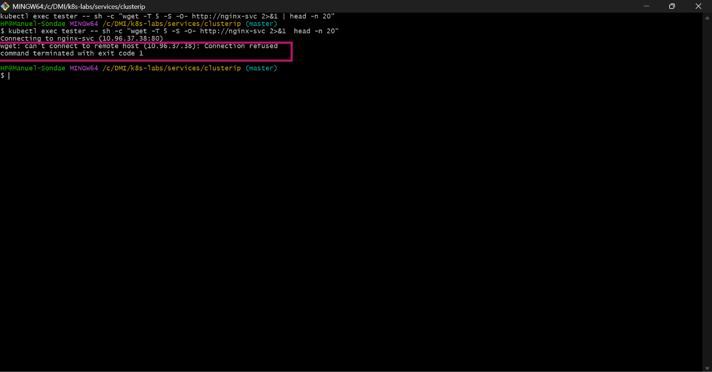

---

#### Screenshot 12 — Restored endpoints and successful Service request

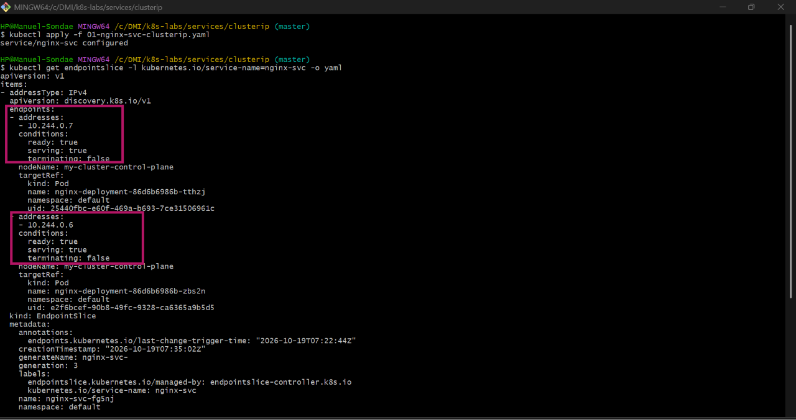
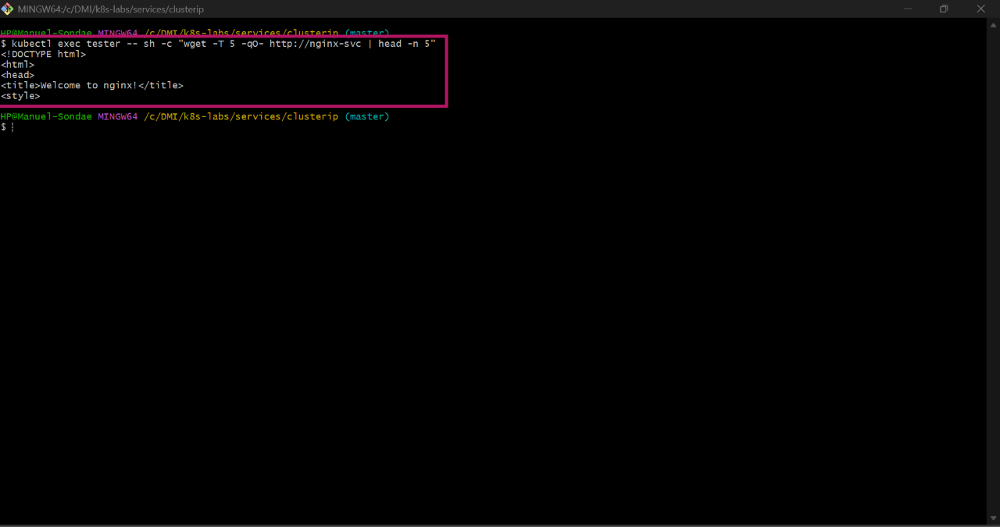

---

### Notes

**1. Why did the Service endpoints become empty?**

The endpoints became empty because the Service selector was changed to an incorrect label value. As a result, no running Pods in the cluster matched the new criteria, leaving the Service with zero backends.

**2. What caused the request from the client Pod to fail?**

The request failed because the Service had an empty endpoints list due to the broken selector contract. With no healthy destination IP addresses listed, the Service had nowhere to route the traffic and dropped the connection.

**3. How did you restore connectivity to the NGINX Pods?**

Connectivity was restored by correcting the Service manifest’s spec: selector: block back to app: nginx. This allowed the Service to instantly find the Pod labels again and re-populate its active endpoints list.

---

# Task 6 — Observe How Readiness Affects Service Routing

## Goal

Observe how a new Pod that fails readiness is excluded from ready Service backends while the existing healthy Pod continues serving traffic.

### Evidence

#### Screenshot 13 — Output showing the Deployment scaled to one ready Pod

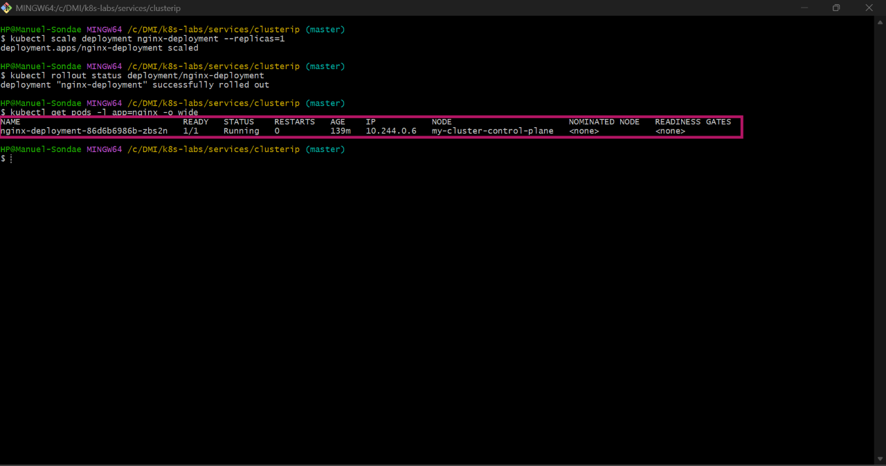

---

#### Screenshot 14 — Completed `03-readiness-broken.yaml` patch file

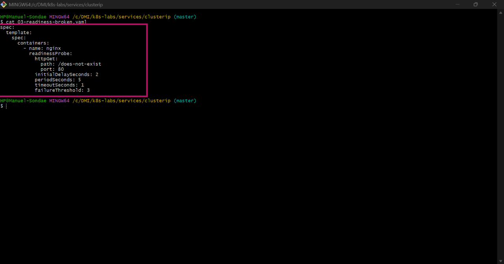

---

#### Screenshot 15 — Output showing the expected incomplete rollout or NotReady Pod

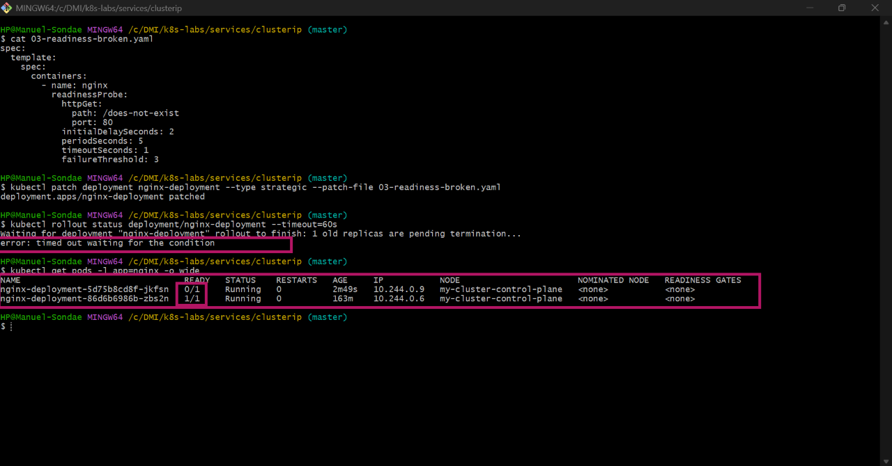

---

#### Screenshot 16 — EndpointSlice output showing the healthy Pod with `ready: true` and the new NotReady Pod with `ready: false`

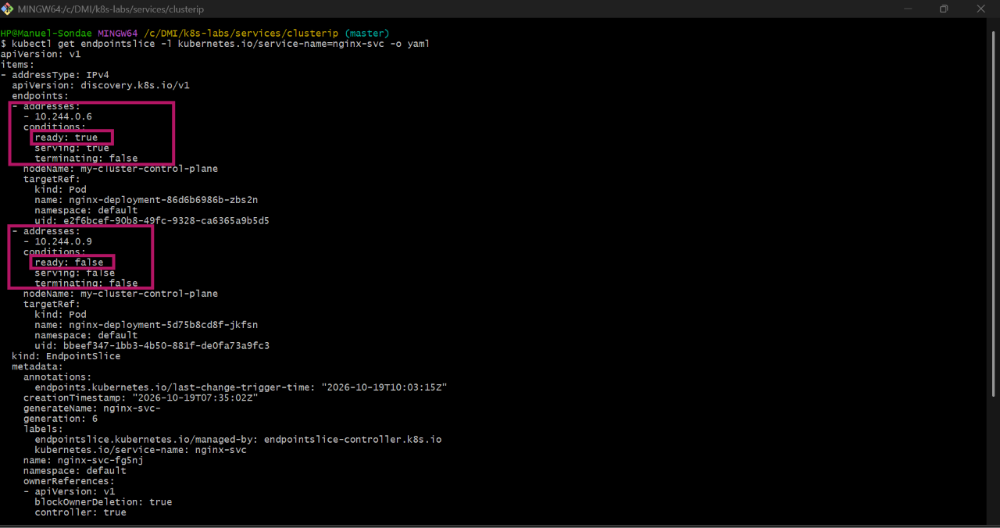

---

#### Screenshot 17 — Service EndpointSlice output showing ready backends after restoring the Deployment

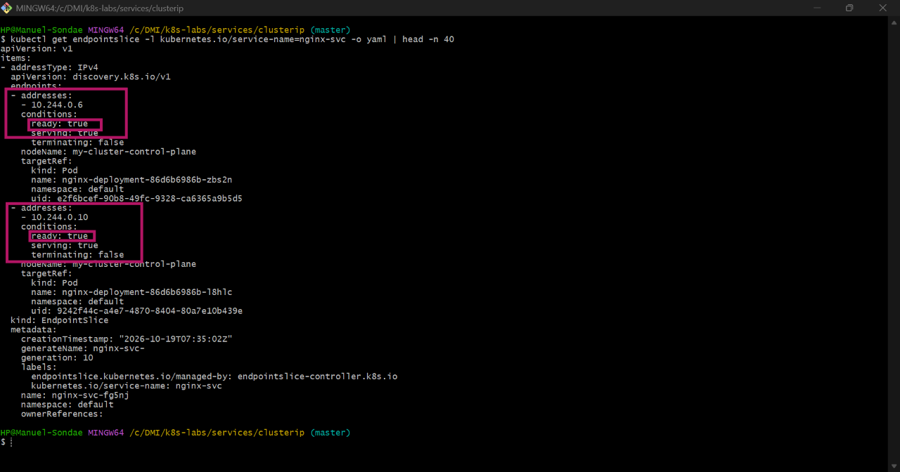

---

### Notes

**1. Why was the new NotReady Pod excluded from ready Service backends?**

The new Pod failed its configured readiness probe check (Ready: 0/1). Kubernetes automatically filters out any unhealthy or unready Pod IPs from the active Service routing pool to avoid sending traffic to broken instances.

**2. What is the relationship between readiness probes and Service routing?**

Readiness probes act as a gatekeeper for Service routing. A Service actively monitors the probe results via its Endpoints/EndpointSlices and will only forward traffic to a Pod if its readiness status is explicitly evaluated as true

**3. Why does this behavior protect users from unhealthy application instances?**

This behavior prevents users from experiencing connection errors or broken webpages. By keeping the old healthy Pod active and isolating the new broken instance during a failed rollout, Kubernetes ensures zero downtime and keeps the application online.

---

# Task 7 — Share Your ClusterIP Service Learning on LinkedIn

## Goal

Share what you learned about ClusterIP Services, Kubernetes DNS, selectors, and readiness-aware Service routing.

### Evidence

#### Screenshot 18 — Published LinkedIn post

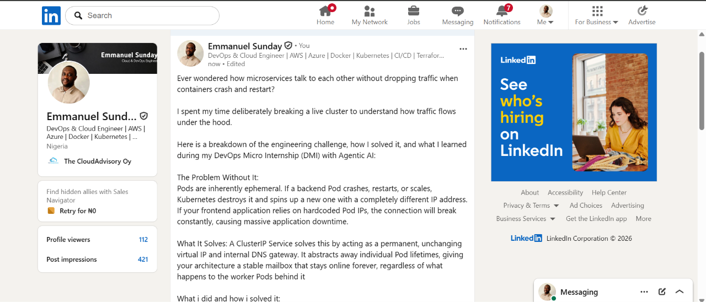

#### Linkedin post link

https://www.linkedin.com/posts/emmanuel-sunday-210a08323_kubernetes-devops-cloudnative-ugcPost-7517935241408167936-tA05/?utm_source=share&utm_medium=member_desktop&rcm=ACoAAFHXXywBq0IrgBBhbi5ULmCrDuZgCEYc6fQ

---

# Submission Instructions

- Add all required screenshots numbered 1–18.
- Ensure your full name is visible in required screenshots.
- Use clear, readable screenshots showing the relevant manifest or output.
- Include the completed NGINX Deployment and ClusterIP Service manifests in your repository.
- Answer all Notes questions for Tasks 1–6 in your own words.
- Include evidence of the intentional failures and successful recovery.
- Do not expose tokens, passwords, kubeconfig files, account IDs, or other sensitive information.

---

# Completion Checklist

- [ ] Learning-cluster context confirmed and previous lab resources removed where applicable
- [ ] ClusterIP lab directory created (Screenshot 1)
- [ ] Healthy NGINX Deployment manifest completed (Screenshot 2)
- [ ] Successful rollout and two ready NGINX Pods verified (Screenshot 3)
- [ ] ClusterIP Service manifest completed (Screenshot 4)
- [ ] Service and backend endpoints or EndpointSlices verified (Screenshot 5)
- [ ] Client Pod created and running (Screenshot 6)
- [ ] Service accessed using DNS name and ClusterIP (Screenshot 7)
- [ ] Service DNS resolution verified (Screenshot 8)
- [ ] Broken selector manifest created (Screenshot 9)
- [ ] Empty endpoints observed (Screenshot 10)
- [ ] Failed Service request captured (Screenshot 11)
- [ ] Original selector restored and connectivity verified (Screenshot 12)
- [ ] Deployment scaled to one ready Pod (Screenshot 13)
- [ ] Broken readiness patch created (Screenshot 14)
- [ ] Incomplete rollout or NotReady Pod observed (Screenshot 15)
- [ ] Readiness effect on Service backends verified (Screenshot 16)
- [ ] Deployment restored and ready Service backends verified (Screenshot 17)
- [ ] LinkedIn post published (Screenshot 18)
- [ ] Notes for Tasks 1–6 completed
- [ ] Required manifests included
- [ ] All required screenshots are clear and readable
- [ ] No sensitive data exposed

---

## 📌 About DMI & CloudAdvisory

DevOps Micro Internship (DMI) is a project-based DevOps program run by Pravin Mishra (The CloudAdvisory) focused on real-world execution, systems thinking, and career readiness.

It helps learners build strong DevOps foundations with hands-on experience.

---

## 📌 Resources

- 🌐 DMI Official Website: https://dmi.pravinmishra.com?utm_source=github&utm_medium=readme  
- 🎓 University: https://university.pravinmishra.com?utm_source=github&utm_medium=readme  
- 💬 Discord Community: https://discord.pravinmishra.com?utm_source=github&utm_medium=readme  
- 📝 Blog: https://dmi.pravinmishra.com/blog?utm_source=github&utm_medium=readme  
- ▶️ YouTube Playlist: https://www.youtube.com/playlist?list=PLFeSNDtI4Cho  
- 🔗 Pravin Mishra (LinkedIn): https://www.linkedin.com/in/pravin-mishra-aws-trainer/  
- 🏢 CloudAdvisory (LinkedIn): https://www.linkedin.com/company/thecloudadvisory/

---

*This submission is part of DevOps Micro Internship (DMI) — Agentic AI Track.*
