# Assignment 8 — Kubernetes Services (NodePort)

Part of the DevOps Micro Internship (DMI) with Agentic AI

---

## Purpose

Create a healthy NGINX Deployment, expose it through a NodePort Service, test access using a node IP and NodePort, and observe how the Service behaves when a backend Pod is replaced.

---

# Task 1 — Set Up Your Lab Directory

## Goal

Create and enter a dedicated directory for the NodePort Service lab.

### Evidence

#### Screenshot 1 — Terminal showing that you are working inside `~/k8s-labs/services/nodeport`

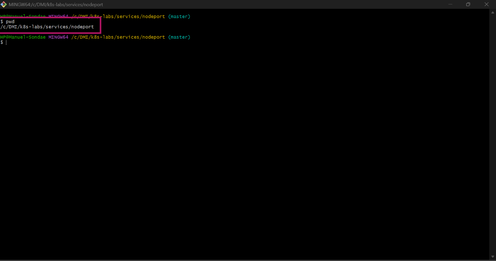

### Notes

**1. What is the difference between ClusterIP and NodePort?**

ClusterIP creates a virtual IP that is only accessible from inside the Kubernetes cluster network. NodePort builds on top of ClusterIP by exposing that internal service externally by opening a specific port (30000–32767) on every physical/virtual Node's IP address.

**2. What does a NodePort Service allow users to do?**

It allows external users or systems outside the Kubernetes cluster network to access an internal application by sending traffic directly to any cluster node's IP address combined with the assigned high-port number.

---

# Task 2 — Create a Healthy NGINX Deployment

## Goal

Create a healthy NGINX Deployment that can act as the backend for the NodePort Service.

### Evidence

#### Screenshot 2 — Completed `00-nginx-deploy.yaml` manifest

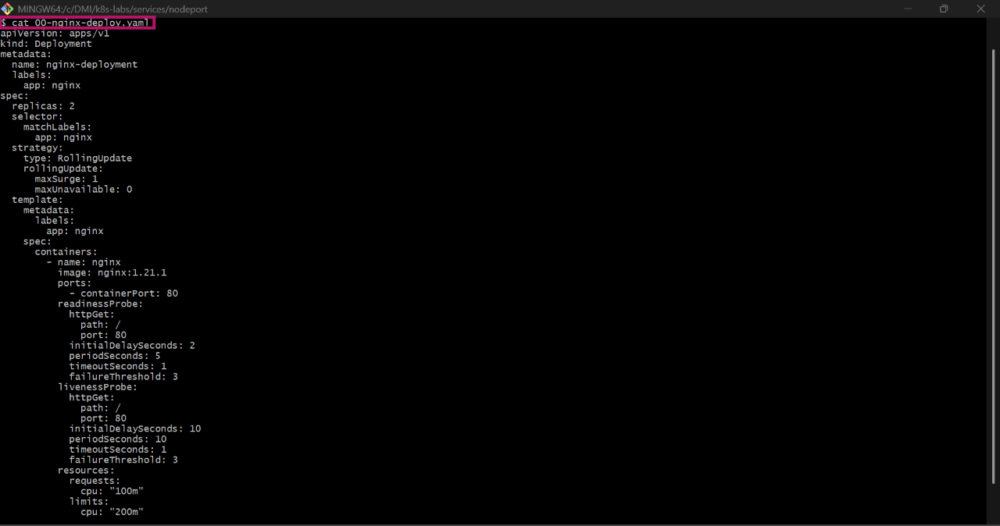

---

#### Screenshot 3 — Output showing successful rollout and two ready NGINX Pods

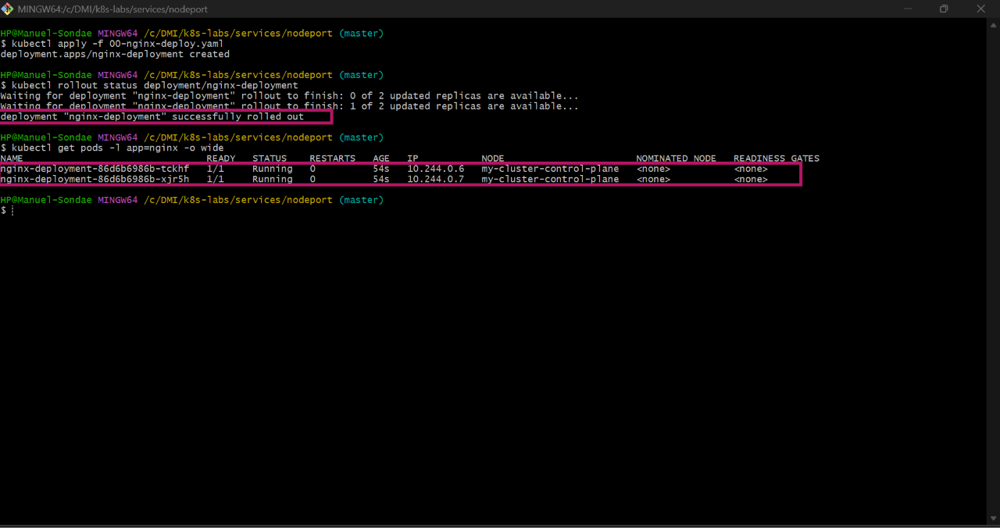

### Notes

**1. Which label will the NodePort Service use to find the NGINX Pods?**

The NodePort Service will use the label selector app: nginx to locate and target the backend Pods.

**2. Why must the Pods be ready before they can receive Service traffic?**

Pods must pass their readiness probes to be marked as ready: true inside the EndpointSlice. If a Pod fails this probe, Kubernetes excludes its IP address from the active Service routing pool so that incoming client requests are never sent to an uninitialized or broken container.

**3. What port does the NGINX container listen on?**

By default, standard NGINX container instances are configured to listen for incoming web requests on standard HTTP port 80

---

# Task 3 — Create the NodePort Service

## Goal

Create a NodePort Service that exposes the NGINX application through a port on every cluster node.

### Evidence

#### Screenshot 4 — Completed `01-nginx-svc-nodeport.yaml` manifest

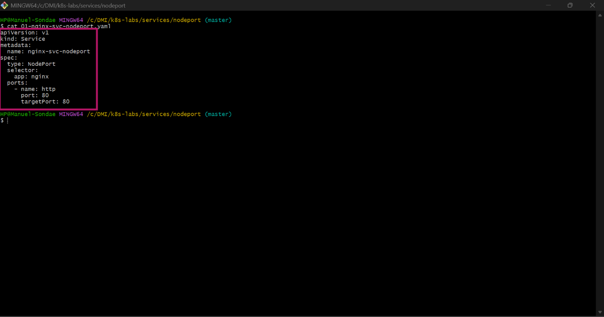

---

#### Screenshot 5 — Output showing the NodePort Service and its endpoints or EndpointSlices

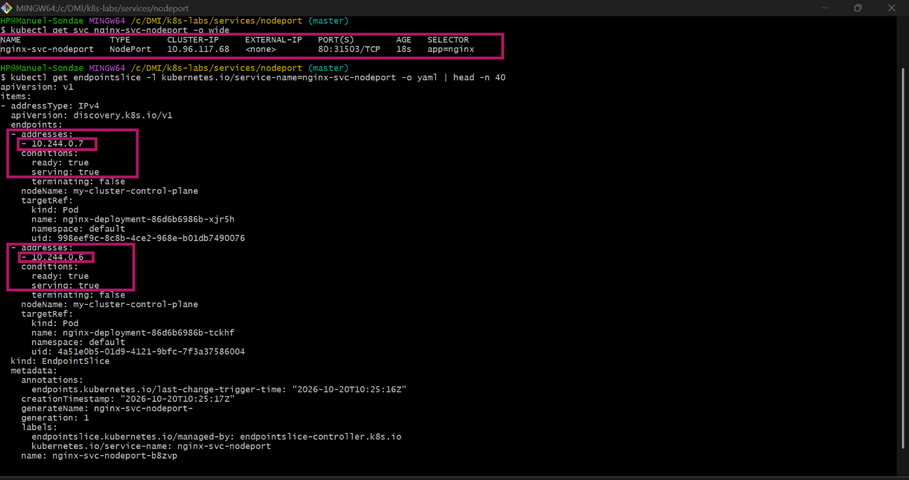

### Notes

**1. What is the purpose of `type: NodePort`?**

Setting type: NodePort instructs the Kubernetes network control plane to allocate a dedicated high-port across all cluster nodes, mapping external node traffic directly down into the service's internal cluster architecture.

**2. What is the difference between `port`, `targetPort`, and `nodePort`?**

The port is the internal cluster service address port, targetPort is the actual container port listening inside the Pod (port 80), and nodePort is the externally accessible port opened on all cluster nodes (e.g., 31503).

**3. What NodePort was assigned or selected in your environment?**

31503

**4. Why do Service endpoints need ready Pods?**

Service endpoints act as an active network routing table. If a Pod is not ready, its IP address is dynamically removed from this routing table so the service doesn't send user requests into a black hole.

---

# Task 4 — Find a Node IP and Test the NodePort

## Goal

Find a reachable node IP and access the NodePort Service.

### Evidence

#### Screenshot 6 — Output of `kubectl get nodes -o wide`

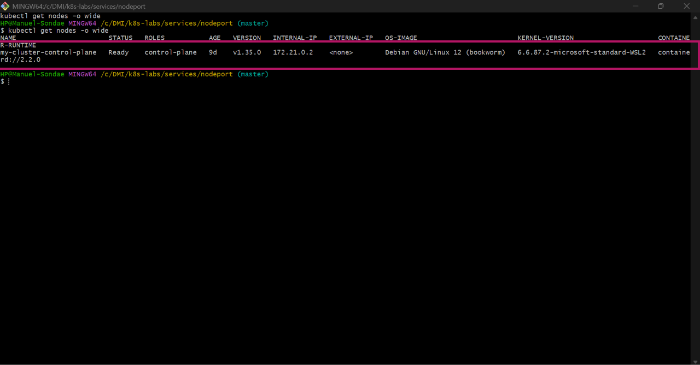

---

#### Screenshot 7 — Output showing the `tester` Pod running

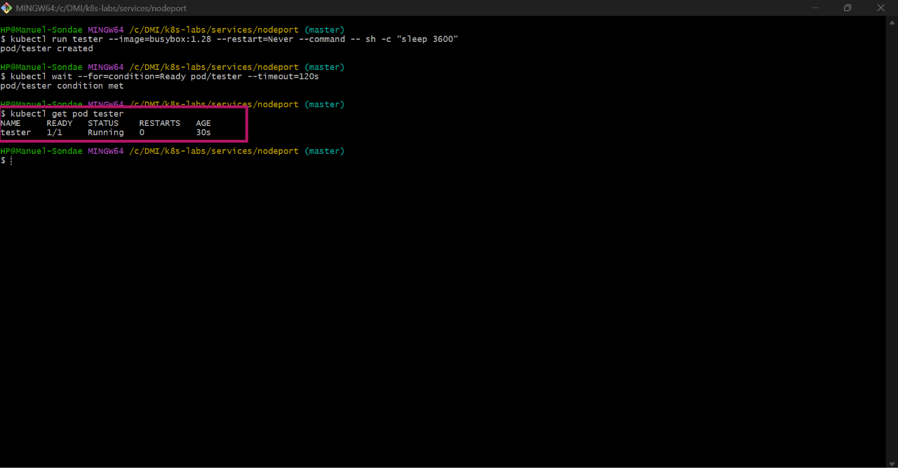

---

#### Screenshot 8 — Successful NodePort response from the laptop or the `tester` Pod

If neither route is supported by your environment, include the failed request output and ready endpoint evidence, and explain the limitation in your Notes.

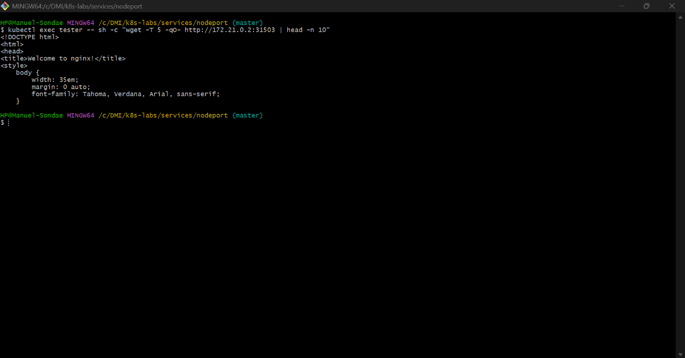

### Notes

**1. Which node IP and NodePort did you test?**

I tested using the node IP  172.21.0.2 combined with the assigned NodePort 31503.

**2. Was your laptop able to reach the NodePort directly? Explain your result.**

No, because the local cluster runs inside a Docker desktop network bridge that blocks direct host-laptop access.

**3. Why can external NodePort access behave differently in Minikube, kind, Docker Desktop, and cloud clusters?**

It behaves differently due to underlying network virtualization layers. Cloud platforms expose public node IPs openly to the internet, whereas local utilities like Minikube, kind, or Docker Desktop isolate nodes inside virtual bridges or hidden VM spaces that restrict outer host OS access.

---

# Task 5 — Optional: Test the Label-Selector Contract

## Goal

Break the Service selector, observe that usable endpoints disappear, and restore the correct selector.

Complete the Evidence and Notes below only if you attempted this optional task.

### Evidence

#### Screenshot 9 — `02-nginx-svc-selector-broken.yaml` showing the incorrect selector

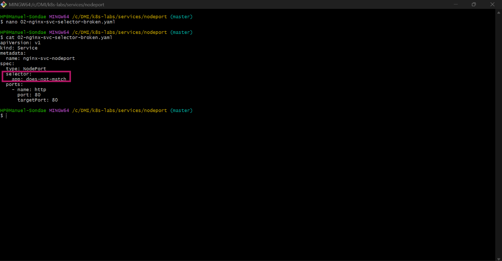

---

#### Screenshot 10 — Empty endpoints or EndpointSlice output after applying the broken selector

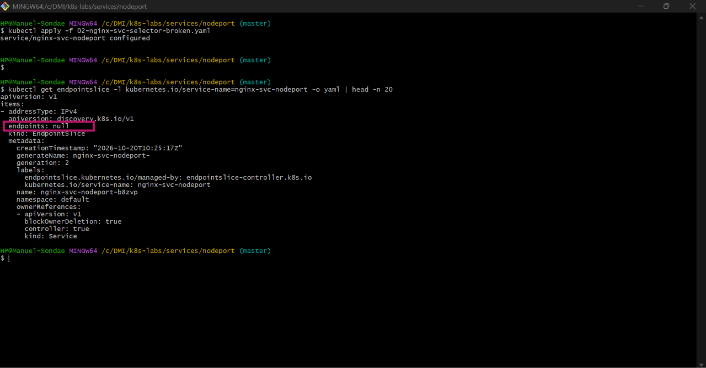

---

#### Screenshot 11 — Restored endpoints or EndpointSlices after applying the original Service manifest

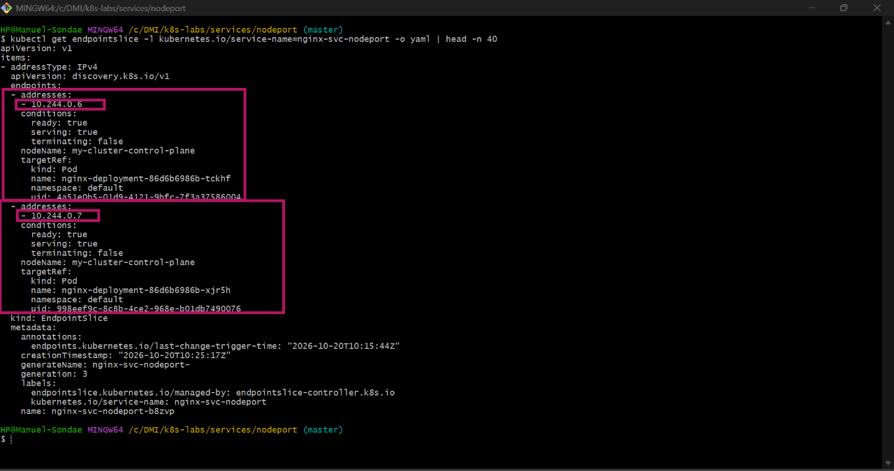

### Notes

**1. Why did the Service endpoints become empty?**

The endpoints dropped to empty because the applied 02-nginx-svc-selector-broken.yaml file modified the selector to an incorrect tag value, meaning no active cluster pods matched the query contract.

**2. Why is NodePort only useful when matching ready Pods exist?**

Even though the external NodePort remains open on the node machines, it will have no backend destination endpoints to hand traffic off to, resulting in absolute connection failure or a "503 Service Unavailable" error for users.

**3. How did you restore the backend connectivity?**

Connectivity was recovered by re-applying the original service manifest containing the correct app: nginx selector layout, which immediately mapped the NodePort route back to the valid backend Pod endpoints.

---

# Task 6 — Observe Resilience During Pod Churn

## Goal

Delete one NGINX Pod and observe its replacement while the Service continues routing traffic to available Pods.

### Evidence

#### Screenshot 12 — Output of the Pod deletion command

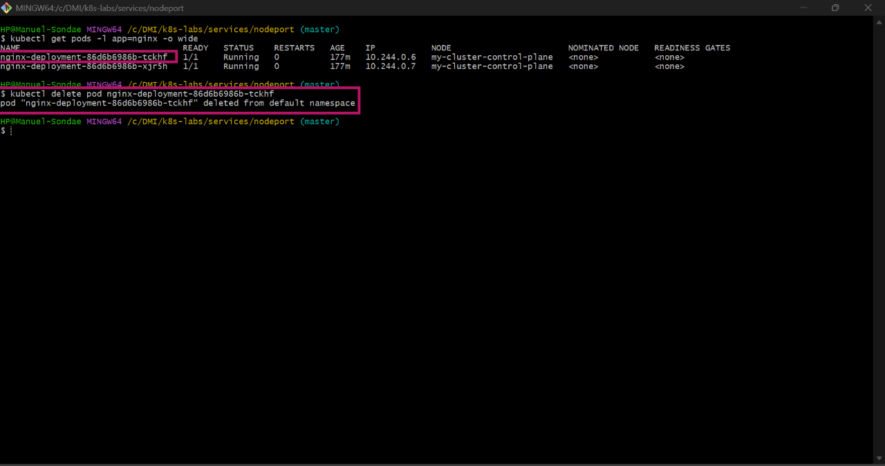

---

#### Screenshot 13 — Output showing the replacement Pod and two running, ready Pods

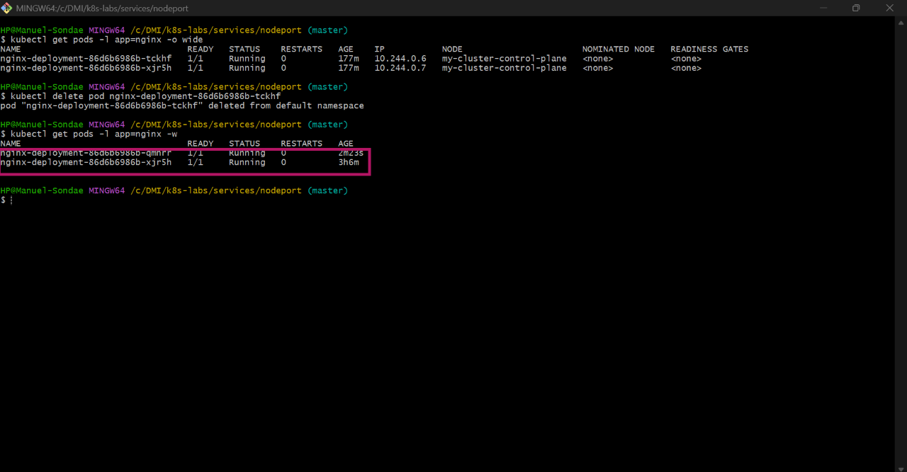

### Notes

**1. What happened after you deleted one Pod?**

The Deployment controller immediately noticed that the current pod count dropped below the desired baseline and instantly spun up a brand-new replacement Pod with a fresh IP address.

**2. Which Kubernetes resource created the replacement Pod?**

The underlying Deployment controller (utilizing its managed ReplicaSet loop) detected the missing capacity state and triggered the creation of the replacement instance.

**3. Why can the NodePort Service continue working during Pod churn?**

While the replacement Pod was booting up, the NodePort Service seamlessly kept routing 100% of network traffic to the remaining healthy Pod, updating its backend endpoint mapping dynamically without causing an application outage.

---

# Task 7 — Share Your NodePort Learning on LinkedIn

## Goal

Share what you learned about NodePort Services, backend Pods, and network access in your Kubernetes environment.

### Evidence

#### Screenshot 14 — Published LinkedIn post about your NodePort Service lab

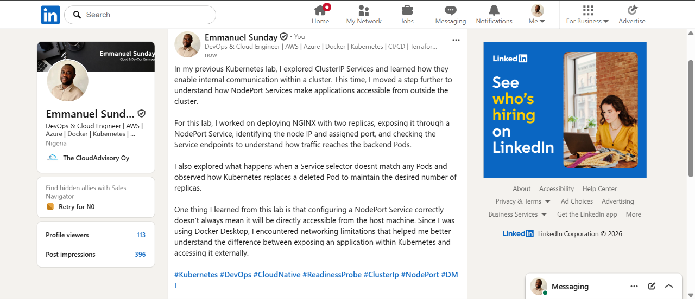

#### Linkedin post link

https://www.linkedin.com/posts/emmanuel-sunday-210a08323_kubernetes-devops-cloudnative-ugcPost-7518318718263652352-m0iA/?utm_source=share&utm_medium=member_desktop&rcm=ACoAAFHXXywBq0IrgBBhbi5ULmCrDuZgCEYc6fQ

---

# Submission Instructions

- Include the completed YAML manifests created during the lab.
- Add all required screenshots: Screenshots 1–8 and 12–14.
- Include Screenshots 9–11 only if you attempted optional Task 5.
- Complete the Notes for Tasks 1–4 and Task 6.
- Complete Task 5 Notes only if you attempted that task.
- Use clear, readable screenshots showing the relevant commands and outputs.
- Ensure your full name is visible in the required screenshots.
- If NodePort access is restricted by your environment, include the failed request output, ready endpoint evidence, and an explanation.
- Do not expose passwords, access tokens, private keys, kubeconfig contents, or account IDs.

---

# Completion Checklist

- [ ] Created and entered `~/k8s-labs/services/nodeport` (Screenshot 1)
- [ ] Created and applied the NGINX Deployment manifest (Screenshot 2)
- [ ] Confirmed successful rollout and two ready NGINX Pods (Screenshot 3)
- [ ] Created the NodePort Service manifest (Screenshot 4)
- [ ] Verified the Service and its endpoints or EndpointSlices (Screenshot 5)
- [ ] Recorded the assigned or selected NodePort
- [ ] Identified a node IP (Screenshot 6)
- [ ] Confirmed that the `tester` Pod is running (Screenshot 7)
- [ ] Tested NodePort access, or documented the environment limitation with evidence (Screenshot 8)
- [ ] Optional: Tested and restored the Service selector (Screenshots 9–11)
- [ ] Deleted one NGINX Pod (Screenshot 12)
- [ ] Confirmed the replacement Pod and two running, ready Pods (Screenshot 13)
- [ ] Completed all required Notes
- [ ] Published the LinkedIn post (Screenshot 14)
- [ ] No sensitive data exposed

---

## 📌 About DMI & CloudAdvisory

DevOps Micro Internship (DMI) is a project-based DevOps program run by Pravin Mishra (The CloudAdvisory) focused on real-world execution, systems thinking, and career readiness.

It helps learners build strong DevOps foundations with hands-on experience.

---

## 📌 Resources

- 🌐 DMI Official Website: https://dmi.pravinmishra.com?utm_source=github&utm_medium=readme  
- 🎓 University: https://university.pravinmishra.com?utm_source=github&utm_medium=readme  
- 💬 Discord Community: https://discord.pravinmishra.com?utm_source=github&utm_medium=readme  
- 📝 Blog: https://dmi.pravinmishra.com/blog?utm_source=github&utm_medium=readme  
- ▶️ YouTube Playlist: https://www.youtube.com/playlist?list=PLFeSNDtI4Cho  
- 🔗 Pravin Mishra (LinkedIn): https://www.linkedin.com/in/pravin-mishra-aws-trainer/  
- 🏢 CloudAdvisory (LinkedIn): https://www.linkedin.com/company/thecloudadvisory/

---

*This submission is part of DevOps Micro Internship (DMI) — Agentic AI Track.*
