# Assignment 09 — Kubernetes Services: LoadBalancer on AKS

Part of the DevOps Micro Internship (DMI) with Agentic AI

---

## Purpose

Deploy a healthy NGINX application to Azure Kubernetes Service (AKS), expose it publicly using a LoadBalancer Service, observe readiness behavior, and scale the application behind the same public endpoint.

---

# Task 1 — Create or Connect to an AKS Cluster

## Goal

Create a small AKS cluster for this lab, or connect to an existing approved AKS lab cluster.

### Evidence

#### Screenshot 1 — Output of `kubectl get nodes` showing ready AKS node(s)

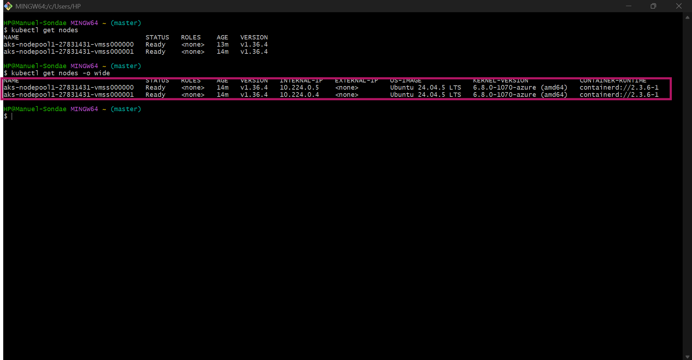

### Notes

**1. Why does this lab use a cloud-capable Kubernetes environment such as AKS for the LoadBalancer Service?**

AKS runs in Azure, which can provision cloud networking resources for a Kubernetes LoadBalancer Service. Unlike some local Kubernetes environments, AKS can create an Azure Load Balancer and assign a public IP address to expose the application to the internet.

**2. What Azure resources can Kubernetes provision when a LoadBalancer Service is created?**

Kubernetes can trigger Azure to provision a load balancer and a public IP address. Azure networking resources and load-balancing rules are configured to direct incoming traffic to the appropriate Kubernetes nodes and application Pods.

**3. Why is it important to delete unused AKS resources after the lab?**

Unused AKS resources can continue generating Azure charges, including charges for cluster resources, public IP addresses, and networking components. Deleting resources that are no longer needed helps control costs and prevents unnecessary resource consumption.

---

# Task 2 — Set Up Your Lab Directory

## Goal

Create and enter a dedicated directory for the LoadBalancer Service manifests.

### Evidence

#### Screenshot 2 — Terminal showing the output of `pwd` confirming that you are working inside `~/k8s-labs/services/loadbalancer`

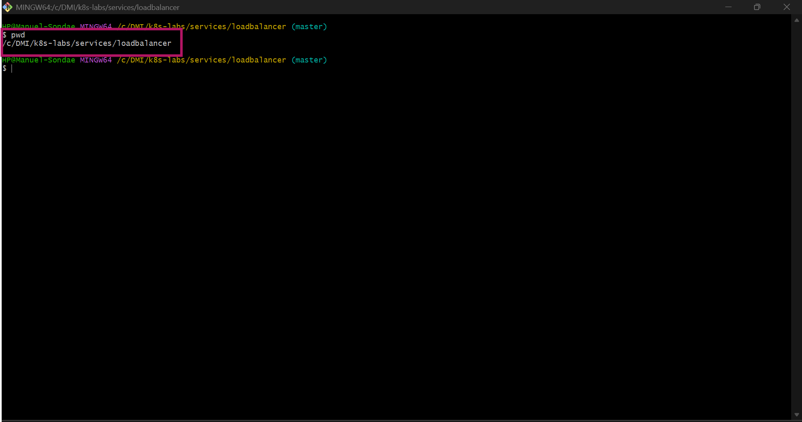

### Notes

**1. Why is it useful to keep Kubernetes manifests organized in dedicated directories?**

Dedicated directories keep Kubernetes configuration files organized and easy to find. This makes it easier to manage resources, troubleshoot problems, reuse manifests, and maintain clear documentation for different labs.

**2. What are the names of the main Deployment and LoadBalancer Service YAML files you will create in this assignment?**

he main files are 00-nginx-deploy.yaml for the NGINX Deployment and 01-nginx-svc-loadbalancer.yaml for the LoadBalancer Service.

---

# Task 3 — Deploy a Healthy NGINX Application

## Goal

Create a healthy NGINX Deployment with readiness and liveness probes.

### Evidence

#### Screenshot 3 — Completed `00-nginx-deploy.yaml` manifest

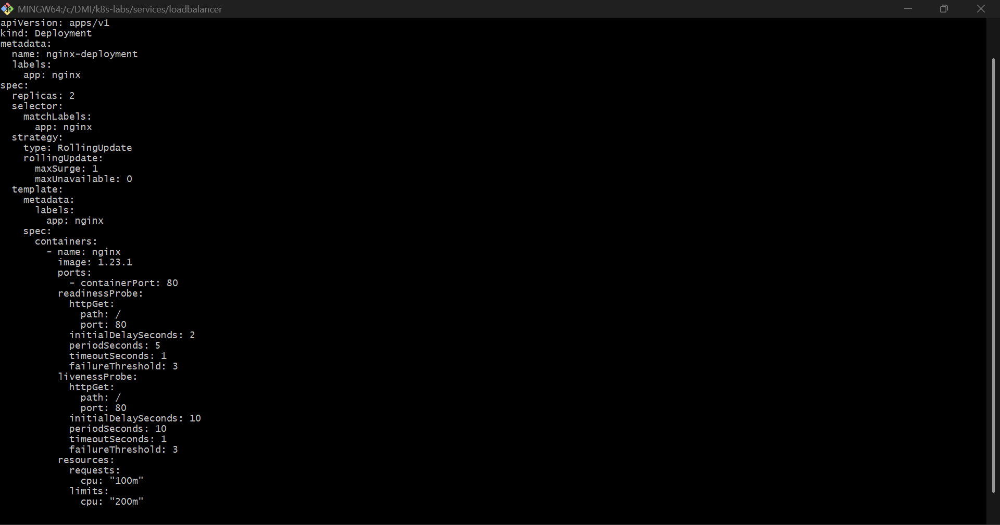

---

#### Screenshot 4 — Output showing successful rollout and two ready NGINX Pods

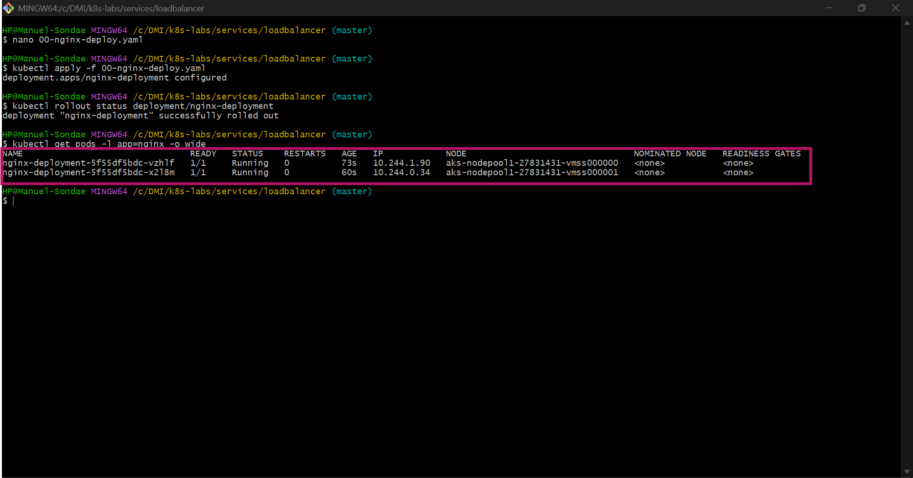

### Notes

**1. Why must Pods be ready before they should receive public traffic?**

Pods should be ready before receiving public traffic to ensure that the application is available to handle requests. Kubernetes uses readiness information to determine which Pods can safely receive traffic through a Service.

**2. What is the role of the readiness probe in this Deployment?**

The readiness probe checks whether the NGINX container is ready to handle requests. If the probe fails, Kubernetes marks the Pod as unready and excludes it from the Service's ready backends until it becomes ready again.

**3. What is the role of the liveness probe in this Deployment?**

The liveness probe checks whether the container is still functioning correctly. If the probe repeatedly fails, Kubernetes restarts the container to help recover from an unhealthy state.

---

# Task 4 — Create and Test the LoadBalancer Service

## Goal

Create a public LoadBalancer Service and verify that the NGINX application is reachable from the internet.

### Evidence

#### Screenshot 5 — Completed `01-nginx-svc-loadbalancer.yaml` manifest

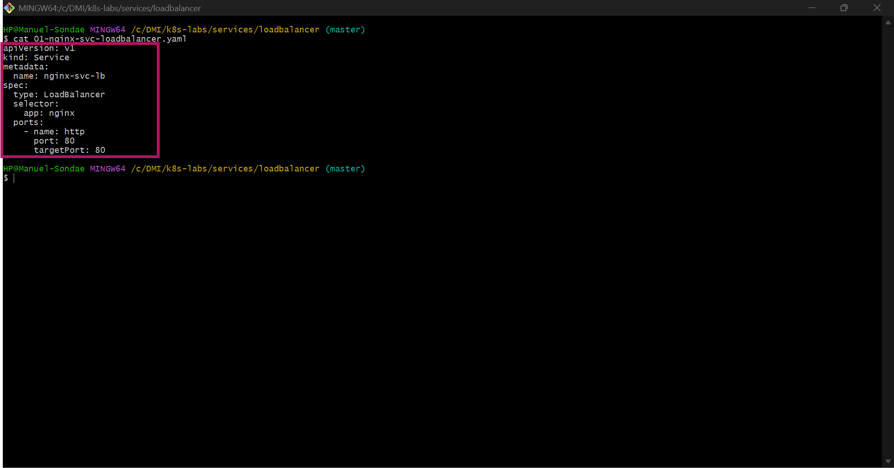

---

#### Screenshot 6 — Output showing the Service with an assigned EXTERNAL-IP

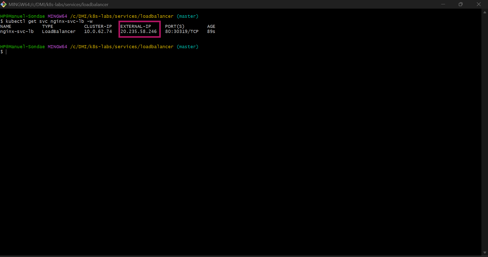

---

#### Screenshot 7 — Successful curl output from the public IP

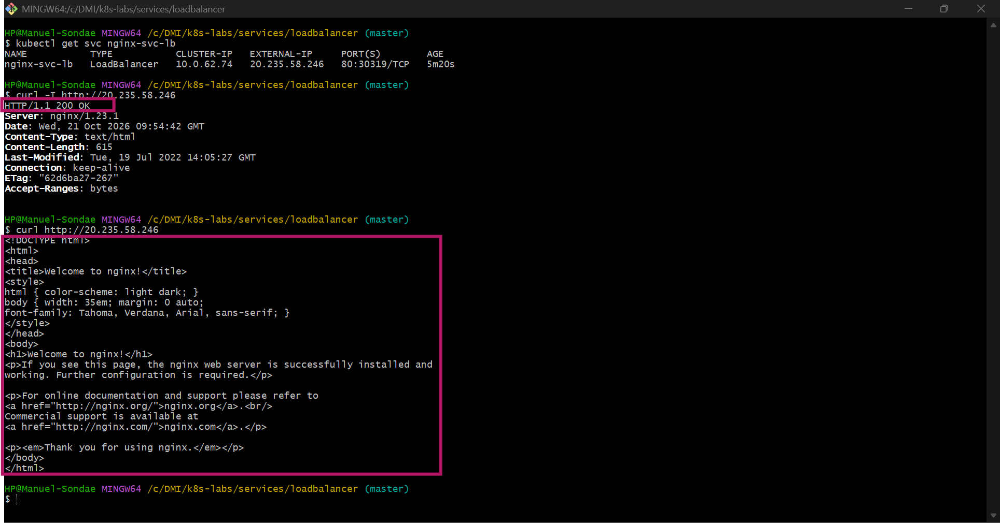

### Notes

**1. What does `type: LoadBalancer` instruct AKS to do?**

Setting type: LoadBalancer instructs Kubernetes to expose the Service through a load balancer. In AKS, this typically triggers Azure to provision or configure a load balancer and assign an external IP address so that clients can access the application from outside the cluster.

**2. What public IP was assigned to your Service?**

The public IP address assigned to my LoadBalancer Service was 20.235.58.246  

**3. How does the public request eventually reach the NGINX Pods?**

A client sends an HTTP request to the Service's public IP address. The Azure Load Balancer directs the incoming traffic to an appropriate Kubernetes node, and Kubernetes networking forwards it to a ready NGINX Pod selected by the Service.

**4. Why should you wait for EXTERNAL-IP before testing the Service?**

The external IP may initially display as <pending> while Azure provisions the necessary networking resources. Waiting until the IP address is assigned ensures that there is a public endpoint to test.

---

# Task 5 — Observe How Readiness Protects Public Traffic

## Goal

Intentionally break readiness and observe how Kubernetes excludes unready Pods from ready Service backends while existing healthy Pods continue serving public traffic.

### Evidence

#### Screenshot 8 — Completed `02-readiness-broken.yaml` patch file

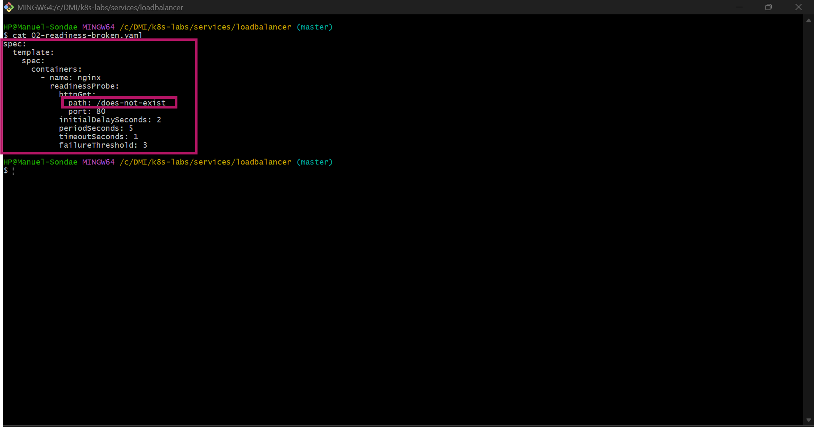

---

#### Screenshot 9 — Output showing the expected incomplete rollout or readiness failure

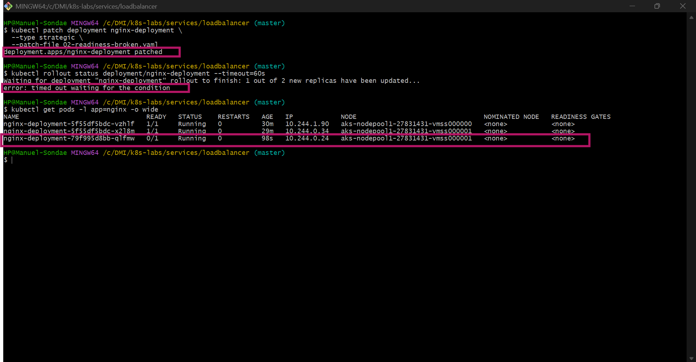

---

#### Screenshot 10 — EndpointSlice output showing ready healthy backends and the effect of the readiness failure

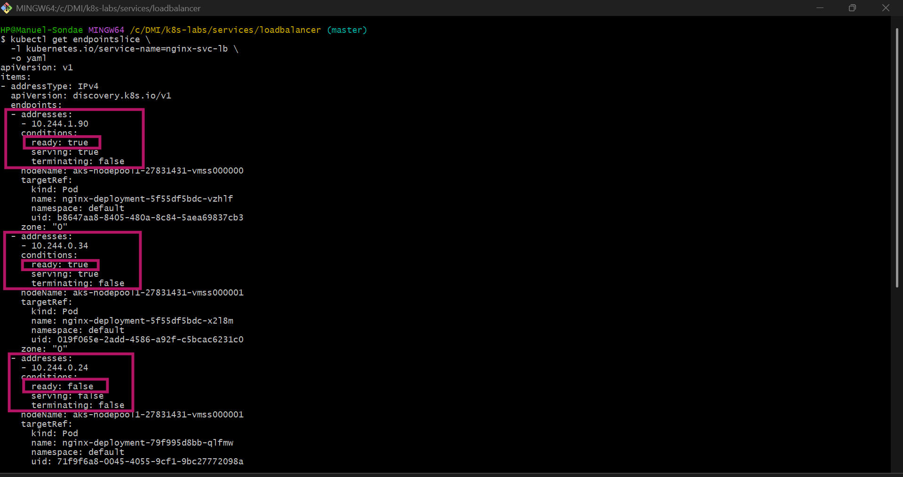

---

#### Screenshot 11 — Successful public curl response after recovery

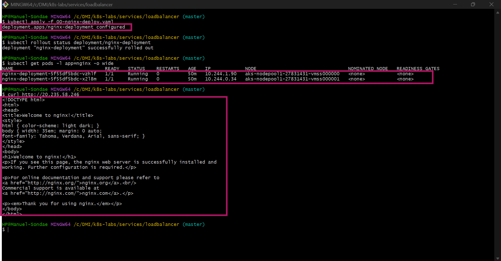

### Notes

**1. Why did the rollout not complete?**

The rollout did not complete because the new Pods failed their readiness checks and could not become ready. Kubernetes therefore could not confirm that the updated Deployment had reached its required healthy state.

**2. Why can the public endpoint still work while new Pods fail readiness?**

The public endpoint can continue working because the Service can still route traffic to existing healthy Pods. Kubernetes excludes unready Pods from its ready backends, allowing the remaining ready Pods to continue serving requests.

**3. What would happen if Kubernetes routed traffic to Pods before they were ready?**

Requests could reach Pods whose applications were not fully initialized or were unable to handle traffic correctly. This could result in failed requests, connection errors, or unexpected application responses.

**4. How did you restore the Deployment successfully?**

I restored the Deployment by applying the valid Deployment manifest and the rollout completed once the required replicas became ready

---

# Task 6 — Scale the Deployment Behind the Load Balancer

## Goal

Scale the NGINX Deployment and confirm that more ready Pods become available behind the same public endpoint.

### Evidence

#### Screenshot 12 — Two ready NGINX Pods verified initially; four ready Pods verified after scaling

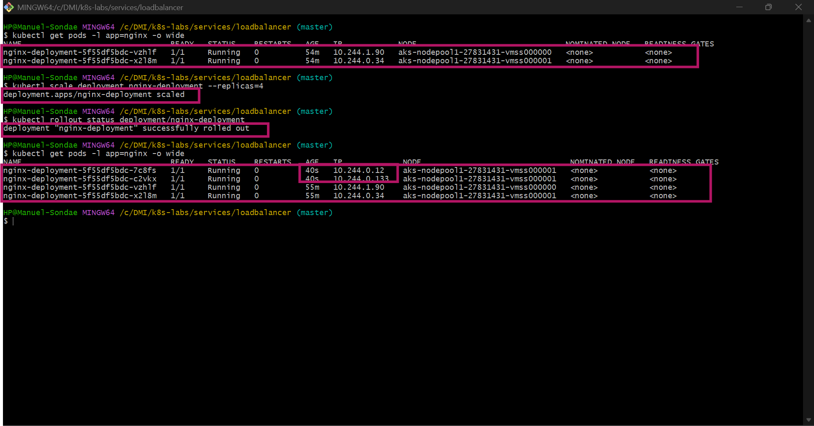

---

#### Screenshot 13 — Successful public curl response after scaling

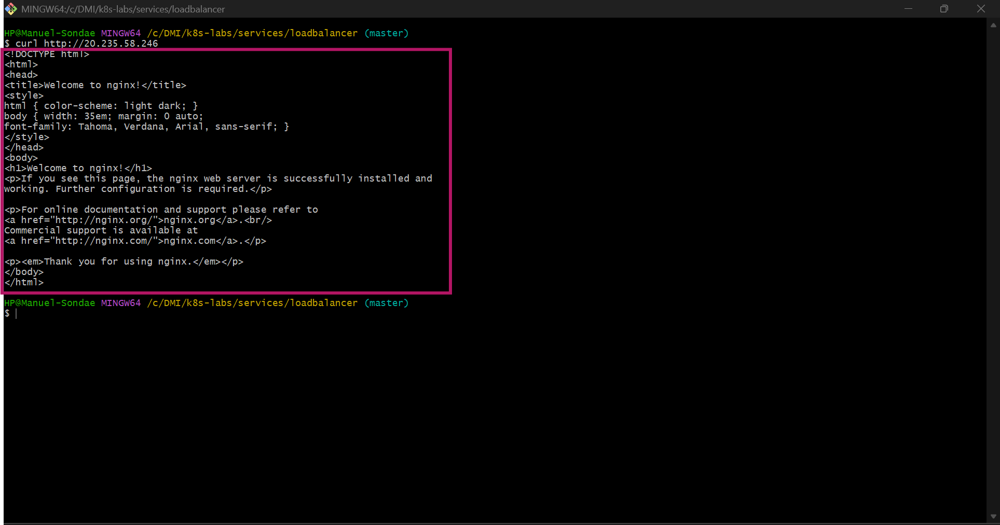

### Notes

**1. What changed after scaling the Deployment from two to four replicas?**

The Deployment increased its desired replica count from two to four. Kubernetes created additional NGINX Pods, and once they became ready, the Service could distribute traffic among a larger pool of healthy backends.

**2. Did the public IP change after scaling? Explain why or why not.**

No, the public IP remained the same because I scaled the existing Deployment without recreating the LoadBalancer Service. The additional Pods became available behind the existing Service and public endpoint.

**3. Why does scaling behind a LoadBalancer Service not require users to change the URL or IP they use?**

The LoadBalancer Service provides a stable public endpoint that remains independent of the number of backend Pods. Kubernetes updates the available backends as the Deployment scales, allowing users to continue accessing the application through the same IP address.

---

# Task 7 — Share Your LoadBalancer Lab on LinkedIn

## Goal

Share what you learned about exposing an NGINX application publicly through a LoadBalancer Service on AKS.

### Evidence

#### Screenshot 14 — Published LinkedIn post about your LoadBalancer lab on AKS

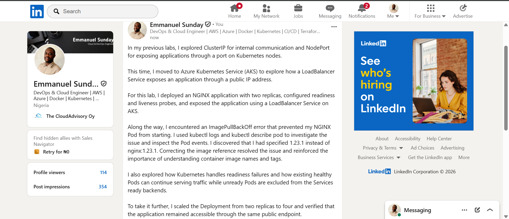

#### LinkedIn post link

https://www.linkedin.com/posts/emmanuel-sunday-210a08323_kubernetes-aks-azure-ugcPost-7518631054212153344-5k_U/?highlightedUpdateUrn=urn%3Ali%3Aactivity%3A7518631057198469120&highlightedUpdateType=SOCIAL_SHARE&origin=SOCIAL_SHARE&utm_source=share&utm_medium=member_desktop&rcm=ACoAAFHXXywBq0IrgBBhbi5ULmCrDuZgCEYc6fQ

---

# Submission Instructions

- Include the completed YAML files:
  - `00-nginx-deploy.yaml`
  - `01-nginx-svc-loadbalancer.yaml`
  - `02-readiness-broken.yaml`
- Add all required screenshots, numbered 1–14, under their corresponding Evidence sections.
- Use clear, readable screenshots showing the relevant commands, configuration, and outputs.
- Ensure your full name is visible in the required screenshots.
- Complete the Notes for Tasks 1–6 in your own words.
- Capture all required evidence before cleaning up Azure resources.
- Plan or complete Azure cleanup according to your lab ownership and reuse arrangements.
- Do not expose passwords, tokens, private keys, cluster credentials, kubeconfig contents, subscription IDs, account IDs, or infrastructure details you are not permitted to share.

---

# Completion Checklist

- [ ] Created or connected to an approved AKS lab cluster
- [ ] Confirmed ready AKS node(s) (Screenshot 1)
- [ ] Created and entered the LoadBalancer lab directory (Screenshot 2)
- [ ] Created the NGINX Deployment manifest (Screenshot 3)
- [ ] Verified successful rollout and two ready NGINX Pods initially (Screenshot 4)
- [ ] Created the LoadBalancer Service manifest (Screenshot 5)
- [ ] Verified the assigned external IP (Screenshot 6)
- [ ] Verified successful public access using curl (Screenshot 7)
- [ ] Created the broken readiness patch (Screenshot 8)
- [ ] Observed the expected incomplete rollout or readiness failure (Screenshot 9)
- [ ] Inspected EndpointSlices during the readiness failure (Screenshot 10)
- [ ] Restored the healthy Deployment and verified public access (Screenshot 11)
- [ ] Scaled the Deployment to four ready Pods and verified updated Service backends (Screenshot 12)
- [ ] Verified public access after scaling (Screenshot 13)
- [ ] Completed the Notes for Tasks 1–6
- [ ] Published the LinkedIn post (Screenshot 14)
- [ ] Included all required YAML files and screenshots
- [ ] Planned or completed Azure cleanup
- [ ] No sensitive data exposed

---

## 📌 About DMI & CloudAdvisory

DevOps Micro Internship (DMI) is a project-based DevOps program run by Pravin Mishra (The CloudAdvisory) focused on real-world execution, systems thinking, and career readiness.

It helps learners build strong DevOps foundations with hands-on experience.

---

## 📌 Resources

- 🌐 DMI Official Website: https://dmi.pravinmishra.com?utm_source=github&utm_medium=readme  
- 🎓 University: https://university.pravinmishra.com?utm_source=github&utm_medium=readme  
- 💬 Discord Community: https://discord.pravinmishra.com?utm_source=github&utm_medium=readme  
- 📝 Blog: https://dmi.pravinmishra.com/blog?utm_source=github&utm_medium=readme  
- ▶️ YouTube Playlist: https://www.youtube.com/playlist?list=PLFeSNDtI4Cho  
- 🔗 Pravin Mishra (LinkedIn): https://www.linkedin.com/in/pravin-mishra-aws-trainer/  
- 🏢 CloudAdvisory (LinkedIn): https://www.linkedin.com/company/thecloudadvisory/

---

*This submission is part of DevOps Micro Internship (DMI) — Agentic AI Track.*
