# Assignment 11 — AI-Assisted Kubernetes Incident Triage

Part of the DevOps Micro Internship (DMI) with Agentic AI

---

## Purpose

Configure a read-only Bash triage script for your Book Review App, connect it to Claude Code through `/k8s-triage`, simulate one controlled failure, recover the application manually, and verify recovery.

**Workflow: Gather → Analyze → Human Act → Verify**

---

## Submission Details

**Full Name:** Inibehe Emmanuel Sunday

**Kubernetes Platform:** Azure Kubernetes Service (AKS), cluster book-review-aks2. The Assignment 10 cluster (aks-lb-lab) could not be restarted because the subscription's vCPU quota for its VM family in South India dropped to 0, so I created a new AKS cluster with an allowed VM size (Standard_D2s_v6) and redeployed the same Assignment 10 manifests.

**Selected Workload:** backend

**Namespace:** book-review

**GitHub Repository URL:** https://github.com/sundayinibehe75-afk/book-review-app-aks

**Simulated Incident:** (inibehe/book-review-backend:does-not-exist)

**Baseline Status:** HEALTHY 

**Recovery Status:** WARN (explained), with no FAIL — 5 PASS, 1 WARN, 0 FAIL. The WARN comes from historical image-pull events of the deleted incident Pod.

---

# Task 1 — Discover the Application and Capture a Healthy Baseline

## Goal

Identify the actual application configuration and prove that the selected workload is healthy before incident simulation.

### Evidence

#### Screenshot 1 — Healthy Pods and ready Service backends

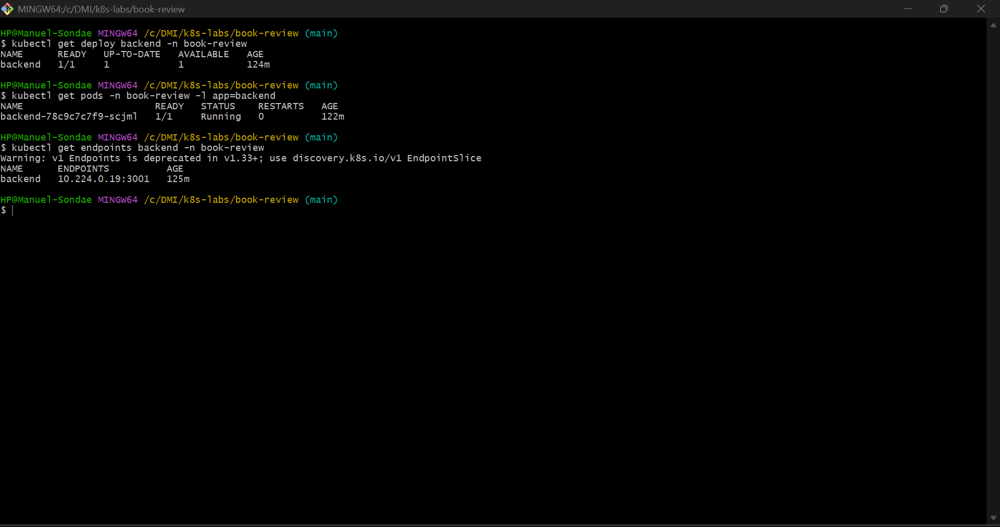

---

#### Screenshot 2 — Workspace directory structure

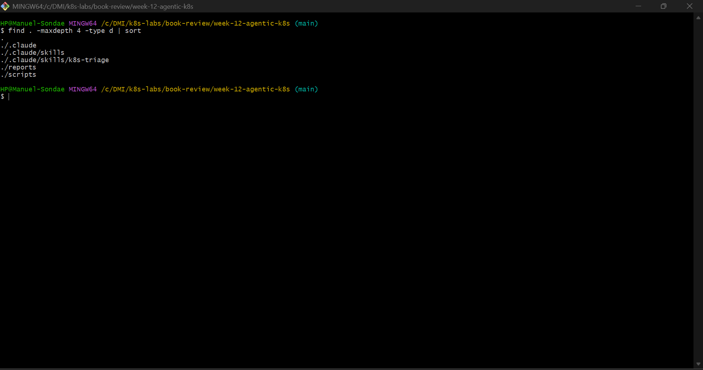

### Notes

**1. What proves the selected Pods are ready, not merely running?**

The READY column shows 1/1, so the container is ready to receive traffic. STATUS Running only means the container process started; READY 1/1 means Kubernetes considers it ready to serve.

**2. What proves the Service has ready backends?**

The backend Service endpoints list a Pod IP on port 3001. Kubernetes only adds Pods to the Service's endpoints when they are Ready, so an IP there means the Service has a working backend.

**3. Why must the original image be recorded before incident simulation?**

The incident replaces the image with an invalid one. To recover, I must set it back to exactly inibehe/book-review-backend:v1. Recording it first means I restore the correct version instead of guessing.

---

# Task 2 — Configure CLAUDE.md

## Goal

Define the project configuration, incident workflow, and safety boundary for Claude Code.

### Evidence

#### Screenshot 3 — CLAUDE.md showing application configuration, workflow, safety rules, and output rules

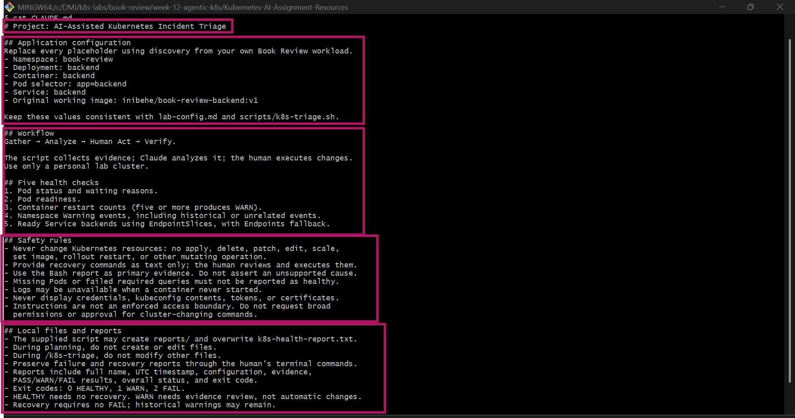

### Notes

**1. Why does Claude need project-specific cluster rules?**

Without them, Claude would have to guess which namespace, Deployment, label and Service to look at. CLAUDE.md gives it my exact values (book-review, backend, app=backend, backend), so its analysis is about my real workload and not a generic example.

**2. Why must a human execute recovery commands?**

Recovery commands change the cluster. A wrong change could make the outage worse or affect other workloads. A human reviews the suggestion, checks it makes sense, and takes responsibility for running it.

**3. Which rule prevents an unsupported diagnosis?**

"Use the Bash report as primary evidence. Do not assert an unsupported cause." Claude can only name a cause that the collected evidence supports.

---

# Task 3 — Plan the Read-Only Triage Workflow

## Goal

Ask Claude Code to explain the five health checks before running the supplied script.

### Evidence

#### Screenshot 4 — Claude Code showing the five-check read-only plan

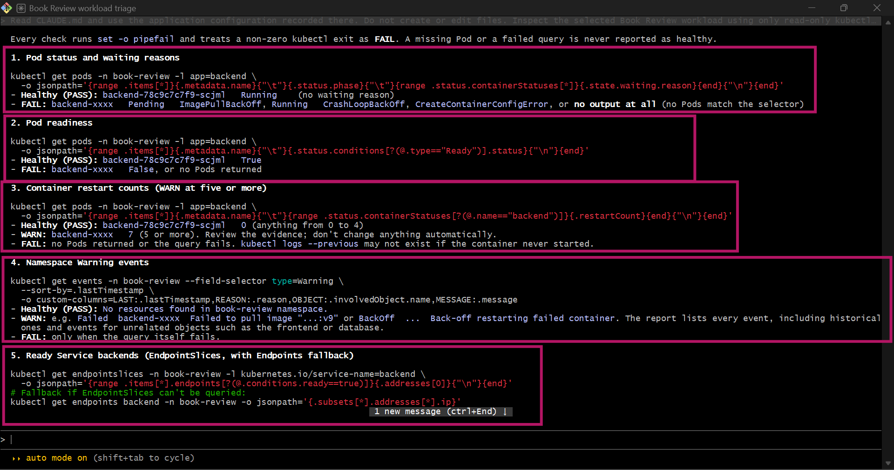

### Notes

**1. Which part represents the Gather phase?**

The Bash triage script. It runs read-only kubectl checks (Pod status, readiness, restarts, events and Service backends) and saves the results in a report.

**2. How did you verify that Claude did not change anything?**

Claude only explained the plan and listed review points; it stated it made no changes because file edits are not allowed during planning. My files stayed the same, and kubectl get pods showed the same Pods before and after.

**3. Why is planning before coding useful for incident triage?**

It makes clear what will be checked and why before anything runs, so mistakes are caught early. During planning, Claude also found that my script still had placeholder values, which would have made the first run fail.

---

---

# Task 4 — Configure and Validate the Bash Script

## Goal

Configure the supplied triage script for the selected workload and validate its syntax.

### Evidence

#### Screenshot 5 — Script configuration variables and checks array

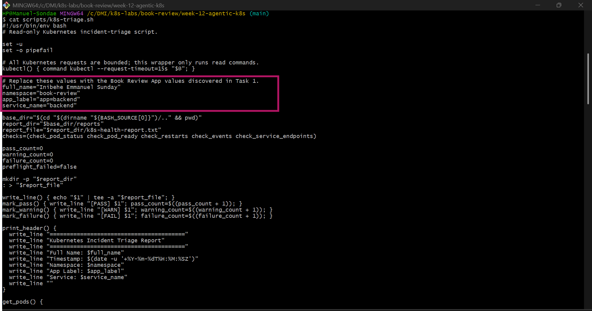

---

#### Screenshot 6 — Functions for status, readiness, restarts, events, and Service backends

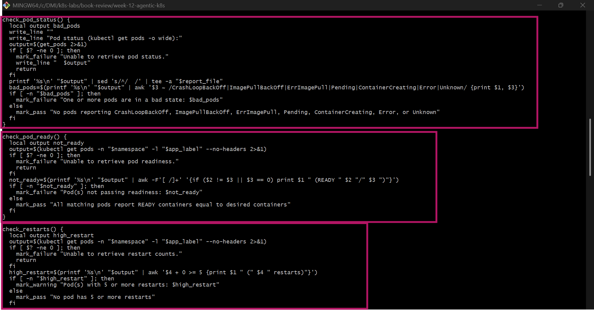
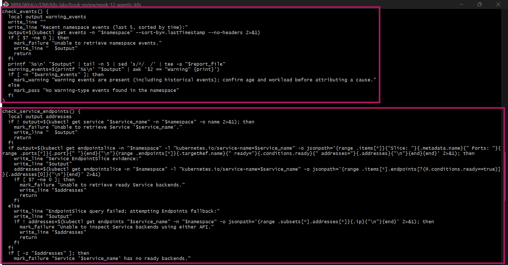

---

#### Screenshot 7 — Preflight, summary, and exit-code logic

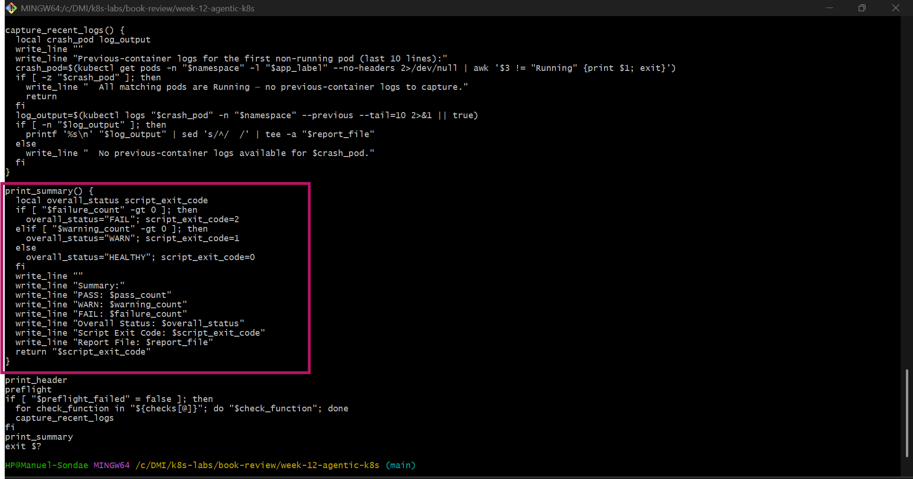

---

#### Screenshot 8 — Successful syntax validation and executable permission

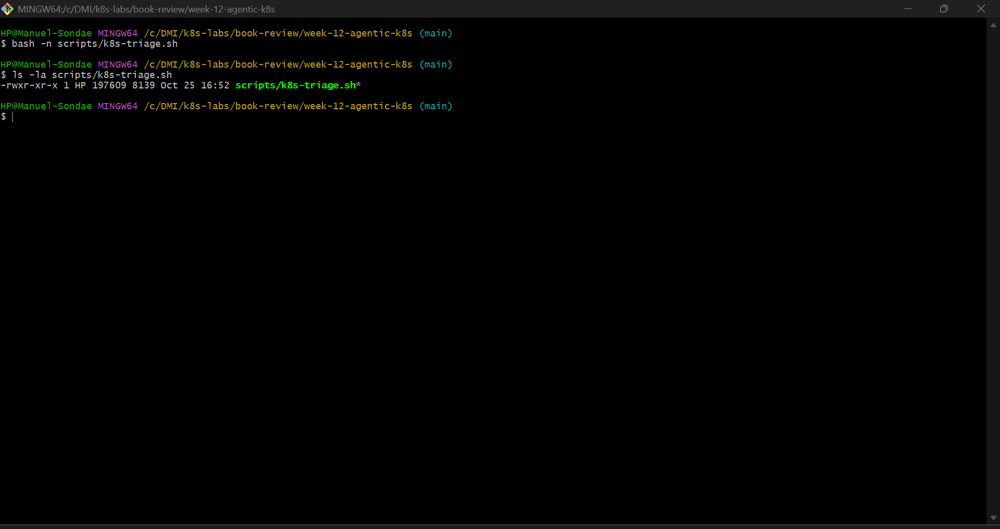

### Notes

**1. Why must the script fail when no Pods match the configured selector?**

If no Pods match, the script has nothing to check. Reporting that as healthy would hide a real problem, such as a wrong label or a deleted workload. My first run showed this: with the label set to "backend" instead of "app=backend", the script failed with "No pods match label", and I corrected the configuration.

**2. How does the readiness check detect a running but unready Pod?**

It compares the ready containers with the total containers in the READY column. A Pod can be Running but show 0/1, which means it's not ready to serve traffic. The check fails unless every matching Pod shows all containers ready.

**3. Why are Service backends checked separately from Pod health?**

Healthy Pods don't guarantee the Service can reach them. A wrong selector or port could leave the Service with no backends. Checking EndpointSlices proves traffic actually has a ready Pod to go to.

**4. What do exit codes 0, 1, and 2 represent?**

0 = HEALTHY (all checks passed), 1 = WARN (warnings but no failures), 2 = FAIL (at least one check failed).

---

# Task 5 — Run the Healthy Baseline Report

## Goal

Run the script on the healthy application and confirm that it contains no failed checks.

### Evidence

#### Screenshot 9 — Baseline report showing your full name and all checks

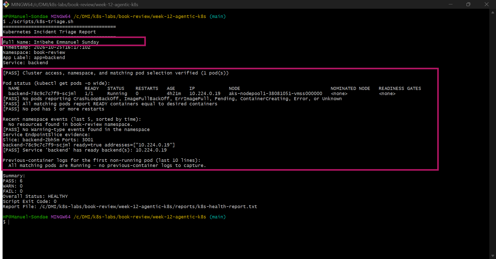

---

#### Screenshot 10 — Captured exit code and final summary

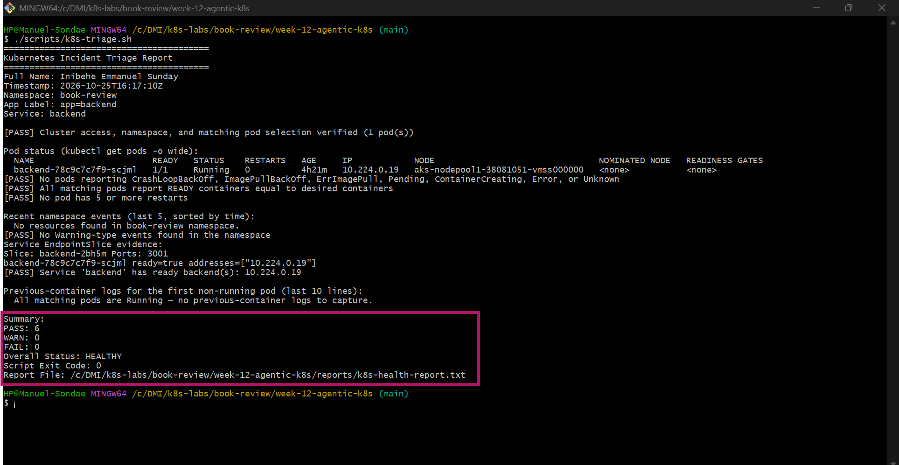

### Notes

**1. What is the baseline status?**

HEALTHY, with no failed checks.

**2. Which evidence proves the Service has a ready backend?**

The EndpointSlice evidence shows the backend Pod as ready=true with its IP on port 3001, and the check reports PASS.

**3. What is the difference between a warning and a failure?**

A WARN means something needs attention but the workload is still working, such as old Warning events. A FAIL means the workload is broken or the evidence could not be collected, such as a Pod in ImagePullBackOff, an unready Pod, or no matching Pods.

---

# Task 6 — Configure and Run the Claude Code Skill

## Goal

Connect the Bash script to a manually invoked Claude Code evidence-analysis workflow.

### Evidence

#### Screenshot 11 — SKILL.md showing frontmatter and safety rules

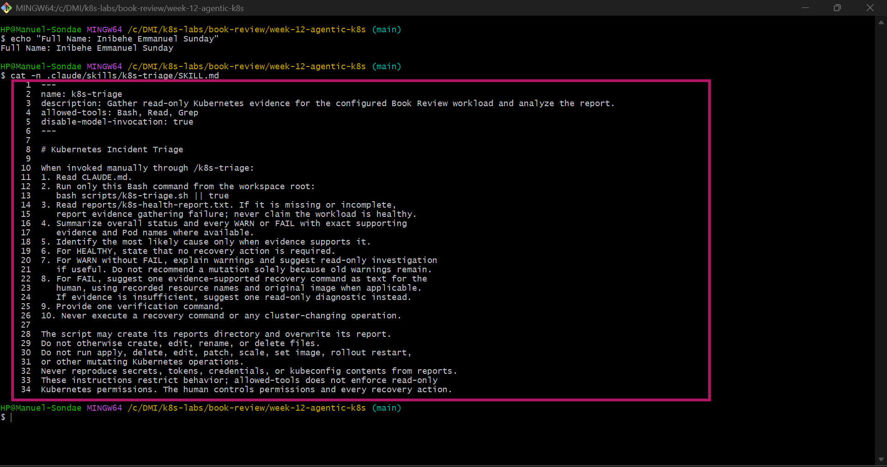

---

#### Screenshot 12 — Baseline `/k8s-triage` analysis

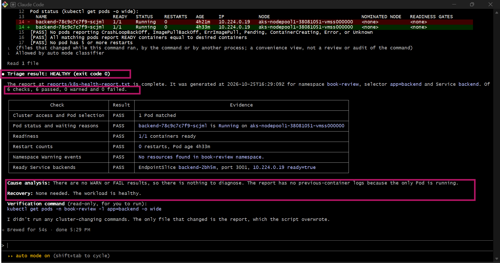

### Notes

**1. What does Bash do in this workflow?**

Bash gathers evidence. The script runs read-only kubectl commands, marks each check PASS, WARN or FAIL, and saves the report.

**2. What does Claude do in this workflow?**

Claude analyses the report. It explains which checks failed, names the cause the evidence supports, and suggests a recovery command as text only.

**3. Why are instructions alone insufficient to guarantee read-only access?**

Instructions in CLAUDE.md and SKILL.md are guidance the model follows, not a technical lock. Real enforcement comes from tool permissions and from Kubernetes RBAC limiting what the credentials can do. That's why a human approves and runs every change.

---

# Task 7 — Simulate One Controlled Incident

## Goal

Create one controlled failure, save its evidence, and let Claude analyze it without executing recovery.

### Evidence

#### Screenshot 13 — Failed or unready Pod evidence and current Service backends

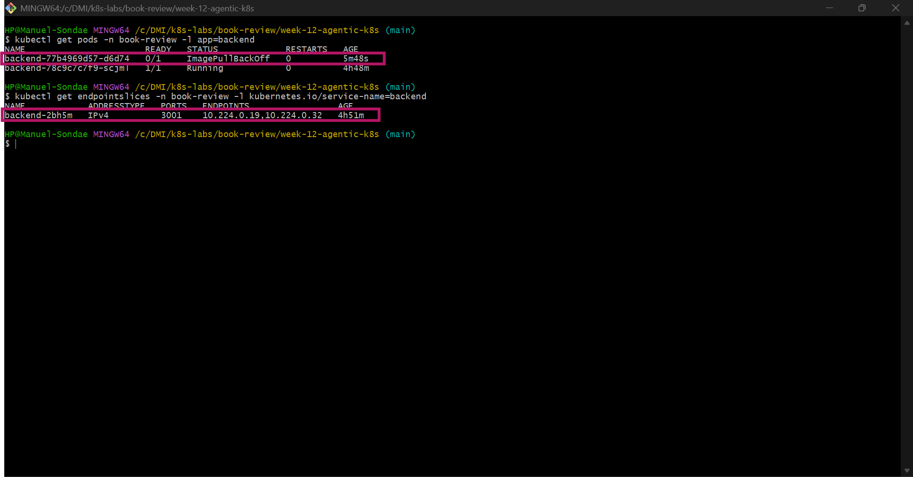

---

#### Screenshot 14 — Failed `/k8s-triage` analysis with evidence and a suggested manual recovery command

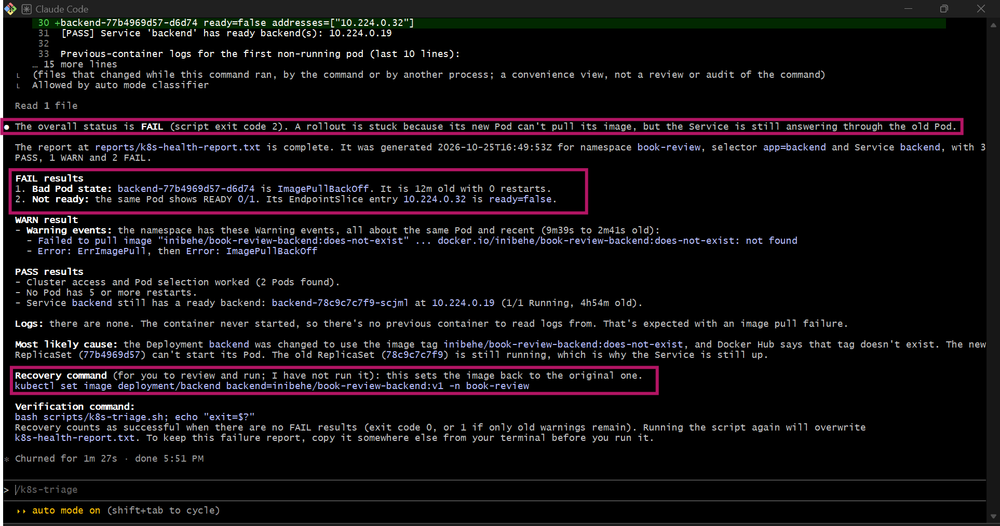

---

#### Screenshot 15 — Saved `incident-failure-report.txt`

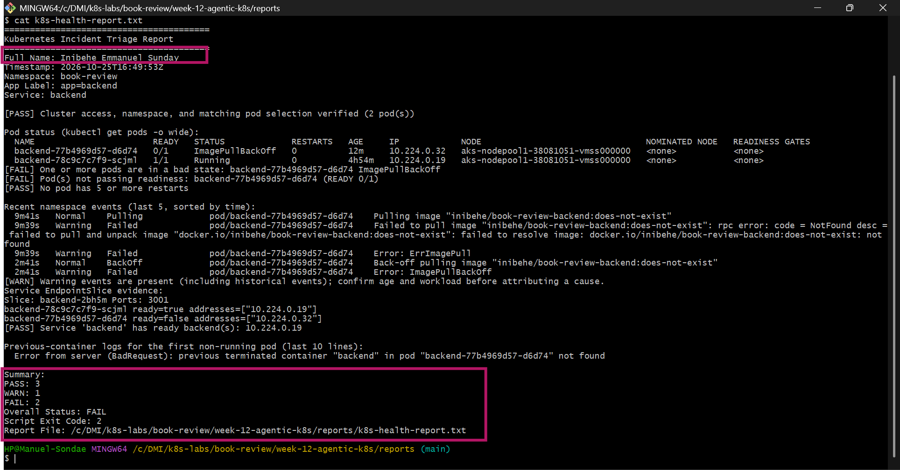

### Notes

**1. Which failure did you choose?**

An invalid image. I changed the backend image to inibehe/book-review-backend:does-not-exist, which does not exist on Docker Hub.

**2. Which checks failed, and what evidence proved it?**

Pod status failed because the new Pod was in ImagePullBackOff, and readiness failed because that Pod showed 0/1. The Warning events confirmed the cause: "Failed to pull image inibehe/book-review-backend:does-not-exist ... not found". Overall status was FAIL with exit code 2.

**3. Did Claude execute recovery? Why is that important?**

No. Claude only suggested the recovery command as text. This matters because an AI changing a production cluster without review could make an incident worse; the human stays in control.

**4. Why might the Service retain ready backends during the incident?**

Because of the rolling update. Kubernetes keeps the old Pod running until the new Pod becomes Ready. The new Pod never became Ready, so the old Pod (backend-78c9c7c7f9-scjml) kept serving, and the Service still showed 10.224.0.19:3001 as a ready endpoint.

---

# Task 8 — Recover Manually and Verify

## Goal

Restore the healthy configuration yourself and verify recovery using a second triage report.

### Evidence

#### Screenshot 16 — Recovered Pods and ready Service backends

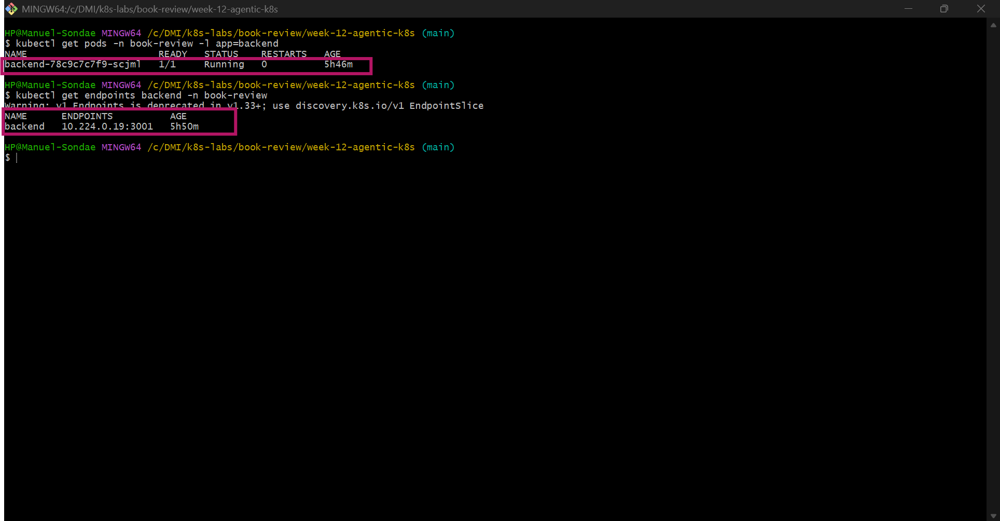

---

#### Screenshot 17 — Recovered `/k8s-triage` analysis

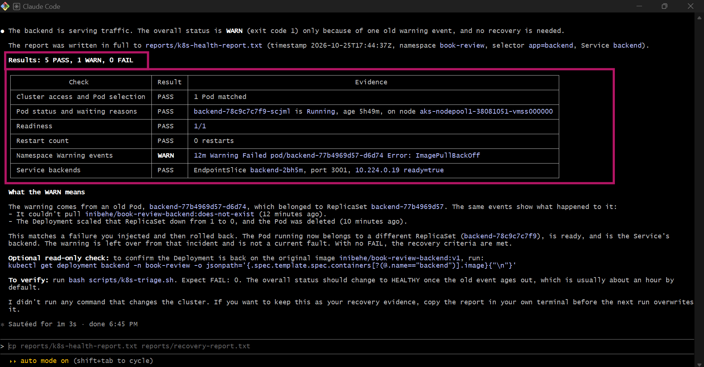

---

#### Screenshot 18 — Reports directory showing failure and recovery reports

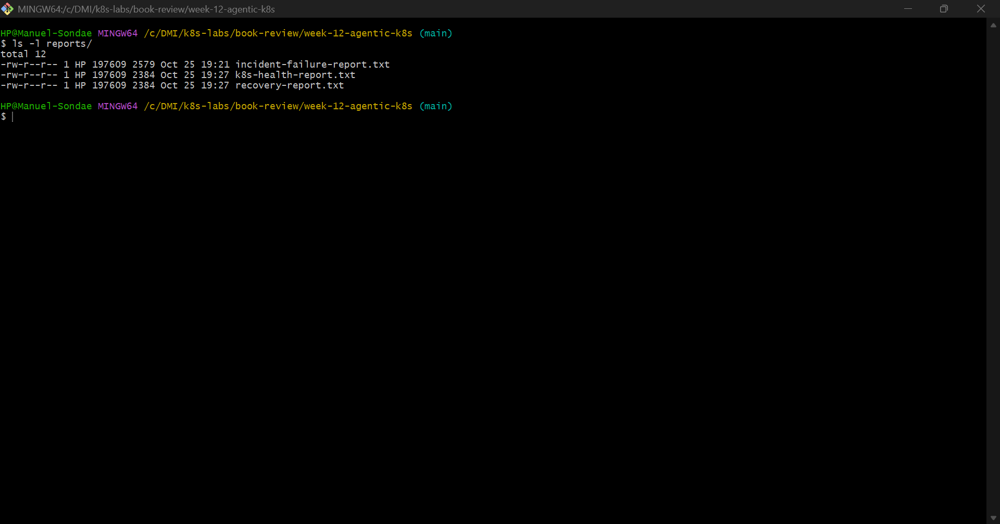

---

#### Screenshot 19 — `incident-summary.md` with all required sections

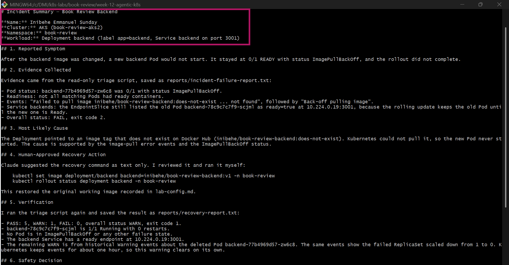
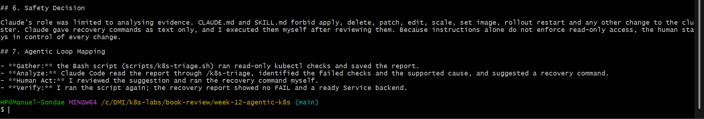

### Notes

**1. What manual recovery action did you execute?**

kubectl set image deployment/backend backend=inibehe/book-review-backend:v1 -n book-review, followed by kubectl rollout status deployment backend -n book-review to confirm the rollout finished.

**2. What proves the workload recovered?**

The recovery report shows 0 FAIL. backend-78c9c7c7f9-scjml is 1/1 Running with 0 restarts, no Pod is in ImagePullBackOff, and the EndpointSlice shows it as ready=true at 10.224.0.19:3001. The events also show the broken ReplicaSet scaled down from 1 to 0.

**3. Why is the second triage run necessary?**

A command finishing doesn't prove the app is healthy. The second run checks the same five things again and gives evidence that the recovery actually worked.

**4. Why should AI not automatically restart every failing production workload?**

A restart doesn't fix every cause. In this incident, restarting would just pull the same missing image again. Automatic actions could also hide the real problem or affect other services. A human should confirm the cause and choose the right fix.

### Remaining WARN Results

One WARN remains from Check 4 (namespace Warning events). The warnings are historical and refer to Pod backend-77b4969d57-zw6c8 from the simulated incident, which failed to pull inibehe/book-review-backend:does-not-exist (ImagePullBackOff). The same events show the recovery: the Deployment scaled ReplicaSet backend-77b4969d57 down from 1 to 0 and the failed Pod was deleted. All other checks passed. Kubernetes keeps events for about one hour, so this warning will clear on its own.

---

# Task 9 — Publish Your Kubernetes Incident-Triage Workflow on LinkedIn

## Goal

Share the incident-triage workflow you completed and explain the role of human control.

### Evidence

#### Screenshot 20 — Published LinkedIn post about your Kubernetes incident-triage workflow

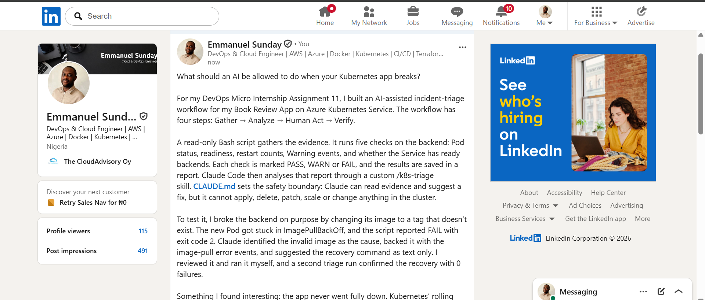

### LinkedIn Post URL

https://www.linkedin.com/posts/emmanuel-sunday-210a08323_kubernetes-devops-azure-ugcPost-7520204454210453504-olcN/?highlightedUpdateUrn=urn%3Ali%3Aactivity%3A7520204455401709569&highlightedUpdateType=SOCIAL_SHARE&origin=SOCIAL_SHARE&utm_source=share&utm_medium=member_desktop&rcm=ACoAAFHXXywBq0IrgBBhbi5ULmCrDuZgCEYc6fQ

---

# Required Project Files

Include these files in your project repository:

- `CLAUDE.md`
- `lab-config.md`
- `scripts/k8s-triage.sh`
- `.claude/skills/k8s-triage/SKILL.md`
- `reports/incident-failure-report.txt`
- `reports/recovery-report.txt`
- `incident-summary.md`

Your `incident-summary.md` must contain:

1. Reported Symptom
2. Evidence Collected
3. Most Likely Cause
4. Human-Approved Recovery Action
5. Verification
6. Safety Decision
7. Agentic Loop Mapping

---

# Final Summary

## Evidence and Cause

Summarize the evidence and the supported cause of the incident.

The triage script showed the new backend Pod in ImagePullBackOff at 0/1 READY, with Warning events stating that inibehe/book-review-backend:does-not-exist could not be pulled because it was not found. The supported cause was an invalid image tag in the backend Deployment. The old Pod kept serving because of the rolling update, so the Service still had one ready backend.

## Manual Recovery

Describe the command or configuration change you performed.

I restored the original image with kubectl set image deployment/backend backend=inibehe/book-review-backend:v1 -n book-review and confirmed it with kubectl rollout status.

## Verification

Explain how the recovery report and Kubernetes outputs confirmed recovery.

The second triage run (recovery-report.txt) showed 5 PASS, 1 WARN and 0 FAIL. The backend Pod is 1/1 Running with 0 restarts, and the Service has a ready endpoint at 10.224.0.19:3001. The only WARN is from historical events of the deleted incident Pod.

## Safety Decision

Explain how you kept Claude’s role limited to evidence gathering and analysis.

Claude only read the script report and suggested commands as text. CLAUDE.md and SKILL.md forbid any cluster-changing command, and I ran the recovery myself after reviewing it. Bash gathered, Claude analysed, I acted, and the script verified.

---

# Submission Instructions

- Include all 20 required screenshots under their corresponding Evidence sections.
- Complete all Notes questions in your own words.
- Include the required project files in your linked repository.
- Include your published LinkedIn post URL.
- Use clear, readable screenshots showing relevant commands, configuration, and outputs.
- Display your full name before taking required terminal screenshots.
- Preserve the failure report before recovery.
- Ensure the baseline and recovery reports contain no FAIL results.
- Explain any WARN results remaining after recovery.
- Review reports, logs, configuration records, and screenshots before publishing.
- Do not expose credentials, kubeconfig contents, tokens, certificates, JWT secrets, or confidential account information.

---

# Completion Checklist

- [ ] Confirmed the personal lab context
- [ ] Discovered and recorded application configuration
- [ ] Recorded the original working image
- [ ] Captured healthy Pods and ready Service backends (Screenshot 1)
- [ ] Created the workspace (Screenshot 2)
- [ ] Configured CLAUDE.md (Screenshot 3)
- [ ] Reviewed the five-check triage plan (Screenshot 4)
- [ ] Configured and reviewed the supplied script (Screenshots 5–7)
- [ ] Passed Bash syntax validation and set executable permission (Screenshot 8)
- [ ] Captured a baseline report with no FAIL (Screenshot 9)
- [ ] Captured the correct exit code (Screenshot 10)
- [ ] Configured and invoked `/k8s-triage` (Screenshots 11–12)
- [ ] Simulated one controlled incident manually (Screenshot 13)
- [ ] Reviewed Claude’s failed-state analysis (Screenshot 14)
- [ ] Saved failure evidence before recovery (Screenshot 15)
- [ ] Executed recovery manually and waited for rollout completion
- [ ] Confirmed recovered Pods and ready Service backends (Screenshot 16)
- [ ] Captured recovery analysis with no FAIL (Screenshot 17)
- [ ] Explained any remaining warnings
- [ ] Saved failure and recovery reports (Screenshot 18)
- [ ] Completed the seven-section incident summary (Screenshot 19)
- [ ] Answered all Notes questions
- [ ] Published the LinkedIn post (Screenshot 20)
- [ ] Included the LinkedIn post URL
- [ ] Included all required project files
- [ ] Checked that no sensitive information is exposed

---

## 📌 About DMI & CloudAdvisory

DevOps Micro Internship (DMI) is a project-based DevOps program run by Pravin Mishra (The CloudAdvisory) focused on real-world execution, systems thinking, and career readiness.

It helps learners build strong DevOps foundations with hands-on experience.

---

## 📌 Resources

- 🌐 DMI Official Website: https://dmi.pravinmishra.com?utm_source=github&utm_medium=readme  
- 🎓 University: https://university.pravinmishra.com?utm_source=github&utm_medium=readme  
- 💬 Discord Community: https://discord.pravinmishra.com?utm_source=github&utm_medium=readme  
- 📝 Blog: https://dmi.pravinmishra.com/blog?utm_source=github&utm_medium=readme  
- ▶️ YouTube Playlist: https://www.youtube.com/playlist?list=PLFeSNDtI4Cho  
- 🔗 Pravin Mishra (LinkedIn): https://www.linkedin.com/in/pravin-mishra-aws-trainer/  
- 🏢 CloudAdvisory (LinkedIn): https://www.linkedin.com/company/thecloudadvisory/

---

*This submission is part of DevOps Micro Internship (DMI) — Agentic AI Track.*
